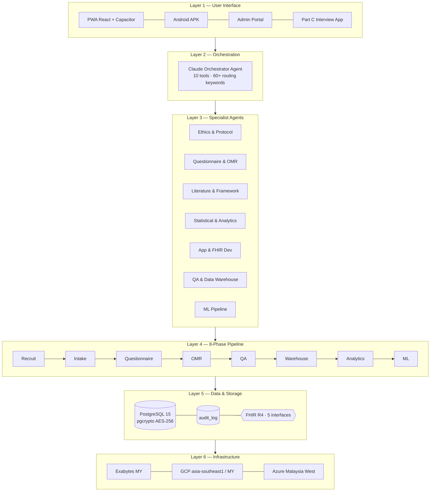
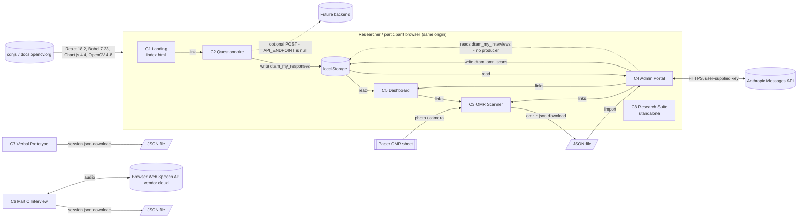
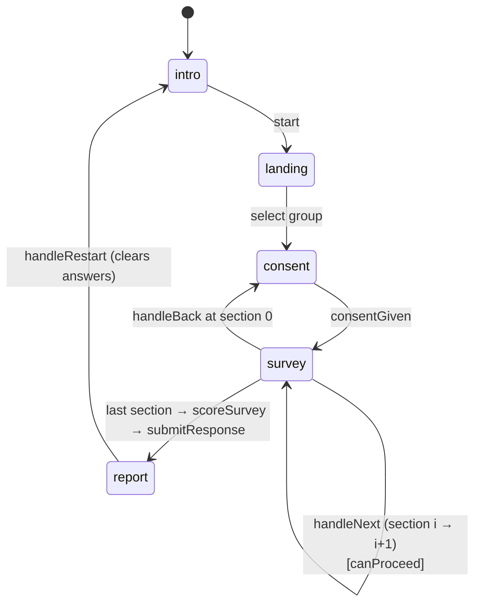
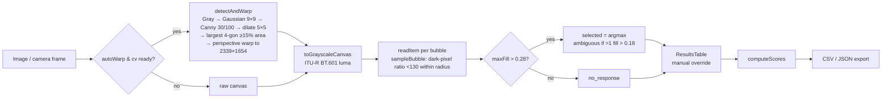
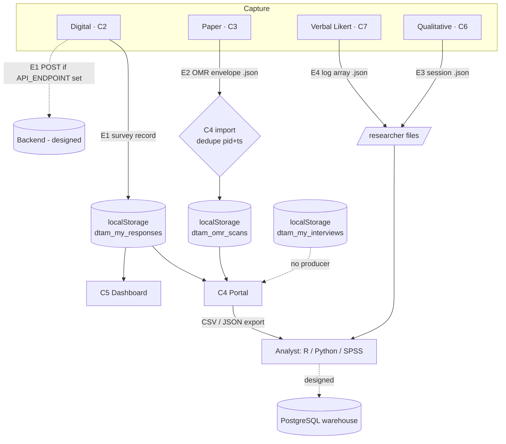
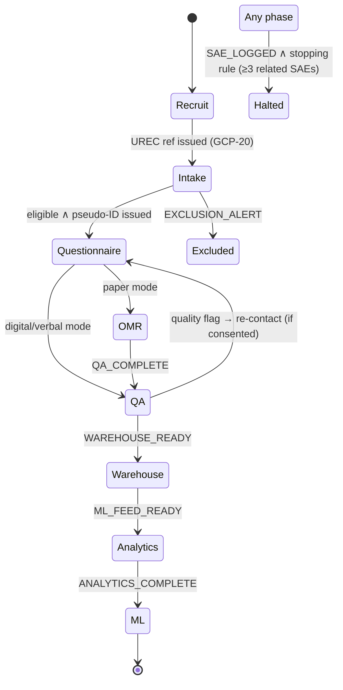
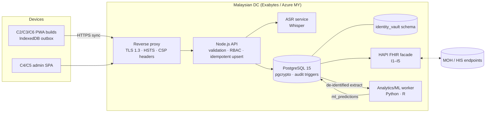

# DTAM-MY System Architecture Specification

**Digital Telerehabilitation Assessment Model — Malaysia (DTAM-MY)**
**Document ID:** DTAM_MY_System_Architecture_Spec_v1.2 · **Status:** Draft for supervisory review · **Date:** 5 November 2026

| Field | Value |
|---|---|
| Prepared by | CHONG Yu Zheng, PhD Candidate (24UED03838) |
| Supervisors | A/Prof Dr Kwan Ban Hoe (Main) · A/Prof. Ir. Dr Goh Choon Hian (Co) |
| Faculty | Lee Kong Chian Faculty of Engineering and Science (LKC FES), Universiti Tunku Abdul Rahman (UTAR) |
| Repository | `joechong9/dtam25` |
| Study ID in code | `DTAM-MY-2025` (`telerehab_questionnaire_app_v2.html:1147`) |
| Sample constants | Total n = 370 · Pilot n = 70 (42 urban + 28 rural; 45 effective completers) · GCP 18/22 (GCP-06 reopened in v1.1; previously 19/22) |

---

## Table of Contents

0. [Document Control & Reading Guide](#s0)
1. [Executive Summary](#s1)
2. [Scope, Sources & Method](#s2)
3. [Architectural Context & Drivers](#s3)
4. [Logical Architecture — Target vs As-Built](#s4)
5. [Component Catalogue](#s5)
6. [Codebase Design Patterns](#s6)
7. [Data Architecture](#s7)
8. [Measurement Framework & DTAM-MY Domains](#s8)
9. [Research Pipeline & Phase Gates](#s9)
10. [AI & Agent Architecture](#s10)
11. [Interoperability — FHIR R4](#s11)
12. [Security, Privacy & Compliance](#s12)
13. [Machine-Learning Architecture](#s13)
14. [Deployment & Infrastructure](#s14)
15. [Platform Trade-Off Analysis](#s15)
16. [Consistency & Traceability Audit](#s16)
17. [Target-State Migration Roadmap](#s17)
18. [Appendices](#s18)

---

<a id="s0"></a>
## 0. Document Control & Reading Guide

### 0.1 Purpose

This document specifies the architecture of the DTAM-MY research system: the software that collects, scores, manages and (in future) analyses data for the doctoral study *Development of Digital Healthcare Telerehabilitation Technology Assessments Model and System for Enhancement of Elderly Quality-of-Life*. It serves three readers:

- **Supervisors and the examination committee**, who need to see how the engineering supports the research design (§[3](#s3), §[8](#s8), §[9](#s9), §[16](#s16)).
- **Developers** extending the codebase, who need the component contracts, data schemas and design patterns (§[5](#s5)–§[7](#s7)).
- **Ethics and data-protection reviewers** (UREC, PDPA), who need the privacy and security posture (§[12](#s12)).

### 0.2 Evidence legend

The workspace mixes *implemented code* with *designed-but-unbuilt* architecture described in the protocol and planning materials. Every claim in this document is tagged so the two are never confused:

| Tag | Meaning |
|---|---|
| ✅ **Built** | Implemented in this repository; file and line reference given. |
| 🟡 **Partial** | Present in code but stubbed, simulated, or not wired end-to-end. |
| 📐 **Designed** | Specified in the protocol / Research Suite / architecture reference; **no code in this repository**. |
| ⚠️ **Conflict** | Two or more sources disagree; resolved or escalated in §[16](#s16). |
| `[NEEDS VERIFICATION]` | Factual or regulatory claim not verified against a primary source. |

### 0.3 Conventions

- Code references use `file:line` (lines as of commit `ccf443b`).
- Component IDs **C1–C8** (§[5](#s5)), design-pattern IDs **DP-01–DP-16** (§[6](#s6)), data-entity IDs **E1–E8** (§[7](#s7)) and audit-finding IDs **F-01–F-27** (§[16](#s16)) are used for cross-referencing throughout.
- "Group" refers to the five stakeholder groups: Allied Health (`allied`), Caregiver (`caregiver`), Elderly post-stroke patient (`elderly`), Policy-Maker (`policy`), General Public (`public`).

### 0.4 Revision history

| Version | Date | Change |
|---|---|---|
| 1.0 | 2026-11-05 | First synthesis from the repository code base and the DTAM-MY architecture reference. |
| 1.1 | 2026-11-05 | Roadmap step 0 applied in code: F-01, F-04, F-13, F-14, F-18, F-21 and F-24 resolved (see §16 status column). GCP-06 reopened → 18/22. SRI deferred. New finding F-26. Line references in §5–§18 remain as of `ccf443b`; small offsets apply in edited files. |
| 1.2 | 2026-11-05 | All findings that can be fixed in client code are resolved: F-02b, F-03, F-04b, F-06 (TUQ, TAM-BI), F-07 (ZBI rule), F-08 (PBKDF2), F-09, F-11, F-12, F-14 (Part C), F-16, F-17, F-19 (SRI via jsDelivr), F-20 (sheet count), F-22, F-23, F-25, F-26, F-27. Remaining open items need research decisions or a backend (see §16 open-items summary). |

---

<a id="s1"></a>
## 1. Executive Summary

DTAM-MY is a mixed-methods measurement system for evaluating telerehabilitation acceptance, usability and quality-of-life impact for elderly post-stroke patients in Malaysia. It covers five stakeholder groups (target n = 370), four languages (English, Bahasa Malaysia, Simplified Chinese, Tamil) and eight validated instruments (TAM, UTAUT2, TUQ, SUS, WHOQOL-BREF, ZBI, MAST, ICF). These are organised into the six-domain **DTAM-MY framework** (§[8](#s8)).

**What is built today (✅).** The repository holds a suite of eight self-contained, single-file HTML applications. They run entirely in the browser and need no server:

| ID | Component | File | Role |
|---|---|---|---|
| C1 | Public landing page | `index.html` (= `index_v2.html`) | Study information, multilingual FAQ chatbot, recruitment entry point |
| C2 | Questionnaire app | `telerehab_questionnaire_app_v2.html` | Digital survey for 5 groups × 4 languages, scoring, local persistence |
| C3 | OMR scanner | `omr_scanner.html` (= `omr_scanner_v2.html`) | Computer-vision reading of paper answer sheets (OpenCV.js) |
| C4 | Admin portal | `admin_portal_v2.html` | Researcher login, recruitment monitoring, data import/export, Claude assistant |
| C5 | Research dashboard | `telerehab_dashboard_v2.html` | Charts of scores, demographics, recruitment and project phases |
| C6 | Part C interview app | `partc_interview_v2.html` | Semi-structured qualitative interviews with live speech-to-text |
| C7 | Verbal interview prototype | `verbal_interview_ui_v2.html` | Interviewer-assisted Likert administration via speech (simulated STT) |
| C8 | Research Suite | `DTAM_MY_Research_Suite.html` | Project-management view: phases, GCP matrix, protocol, frameworks, SDG indicators |

The components work together through a **browser-local data bus** (`localStorage`, DP-07) and **JSON file interchange** (DP-08), not through a backend. The questionnaire app already has a dual-write hook (`DTAM_CONFIG.API_ENDPOINT`, DP-09) ready for a future server.

**What is designed but not built (📐).** The target architecture has six layers: UI → Claude multi-agent orchestration → specialist agents → 8-phase pipeline → PostgreSQL/FHIR R4 data layer → Malaysian-hosted infrastructure. It adds a machine-learning outcome predictor and five FHIR R4 interfaces (Advisory A3). None of the backend, agent, FHIR or ML layers exists in this repository yet. Planning materials in the code describe the PWA as "React + Node.js + PostgreSQL" and as complete (`DTAM_MY_Research_Suite.html:285`). The as-built system is client-only, with no service worker, manifest, Node backend or database.

**Top findings for supervisory attention** (full list in §[16](#s16)):

1. **Blocked citation in the compliance record (F-01) — ✅ resolved in v1.1.** The "National Digital Health Blueprint 2023–2030" appeared as GCP-06 (counted towards 19/22), as live questionnaire item `pol2`, in helper text and ethics badges, and on the landing page. It has been removed everywhere. `pol2` is reworded neutrally ("Current national digital health policy provides clear guidance…"), and GCP-06 is reopened as *National digital health policy alignment (source pending verification)*, so the score is now **18/22 (82%)**. A verified MOH policy source is still needed before GCP-06 can close. `[NEEDS VERIFICATION]`
2. **Three incompatible item-coding schemes (F-02).** The digital questionnaire, the paper/OMR route and the verbal route use different item counts and codes for the same instrument (e.g., TAM has 7 items digitally and 10 on paper; UTAUT2 has 10 digital items covering all 7 constructs, while the paper version has 18 items covering 6 constructs and omits Performance Expectancy and Price Value). Responses from different modes cannot be pooled for EFA/PLS-SEM without a harmonisation layer (§[7.6](#s7-6)).
3. **Broken data contracts (F-03, F-04).** The admin portal reads interview records from a storage key that no app writes, and the Part C export schema does not match what the portal expects. The admin portal reads `r.lang` while the questionnaire stores `meta.lang`.
4. **Client-side-only security (F-08–F-12).** Authentication, password hashing (unsalted SHA-256) and the 8-hour session are enforced only in the browser. Participant data sits unencrypted in `localStorage`. Before real participant data is collected, the planned controls (pgcrypto AES-256, audit_log, RBAC) must exist on a server.
5. **Conflicting ML specifications (F-15).** LSTM + Random Forest with LOOCV (architecture reference) versus Random Forest + XGBoost with 5-fold CV and AUC ≥ 0.75 (protocol §10). §[13](#s13) recommends one reconciled design.


> **Status at v1.2:** Finding 1 is resolved in code (a verified source is still needed). Findings 3 and 5 are fixed or reconciled where code allows. Finding 4 is hardened (PBKDF2, persistent lockout, tokens, escaping, STT opt-in) but still needs a backend. Finding 2 needs an instrument decision. See the open-items summary at the end of §[16](#s16).

---

<a id="s2"></a>
## 2. Scope, Sources & Method

### 2.1 Source inventory

The request was to synthesise "all linked markdown notes and project files". The workspace contains **no markdown notes** apart from a two-line `README.md` (`# dtam25 / DTAM 25`). The synthesis therefore uses the following sources:

| # | Source | Type | Size | Notes |
|---|---|---|---|---|
| S1 | `index.html` / `index_v2.html` | Code | 2,620 lines each | Byte-identical (MD5 `9cef6276…`) |
| S2 | `telerehab_questionnaire_app_v2.html` | Code | 3,085 lines | Largest component; item bank, i18n, scoring |
| S3 | `omr_scanner.html` / `omr_scanner_v2.html` | Code | 1,107 lines each | Byte-identical (MD5 `e7397722…`) |
| S4 | `admin_portal_v2.html` | Code | 1,693 lines | Auth, import/export, Claude chat |
| S5 | `telerehab_dashboard_v2.html` | Code | 1,122 lines | Chart.js analytics |
| S6 | `partc_interview_v2.html` | Code | 1,025 lines | Qualitative interview, Web Speech API |
| S7 | `verbal_interview_ui_v2.html` | Code | 687 lines | Verbal Likert prototype |
| S8 | `DTAM_MY_Research_Suite.html` | Code + embedded docs | 811 lines | Contains the **Master Protocol v2.0** text (11 sections), GCP matrix, framework catalogue and SDG formulas. This is the closest thing to "project notes" in the repo. |
| S9 | DTAM-MY LLM Architecture reference (skill library, `arch-content.md`) | External design note | 15 sections | Source of the six-layer, multi-agent, FHIR and ML design (📐 items) |
| S10 | `README.md` | Markdown | 2 lines | No content |

Total: 10 files in the repo, 8 unique applications, about 15,900 lines and 1.2 MB of HTML/JS.

### 2.2 Method

1. **Static structural analysis.** Function and constant inventories, storage-key and network-call extraction, cross-file link graph (`href`, `window.open`, URL parameters).
2. **Contract tracing.** For each `localStorage` key and each exported JSON format, the producer and consumer were identified and their field names compared (§[7](#s7)).
3. **Instrument reconciliation.** The item banks in S2, S3, S7 and S8 were compared item by item against each other and against the standard scoring rules (§[7.6](#s7-6), §[8](#s8)).
4. **Design-versus-build comparison.** Every architectural claim in S8 and S9 was checked against the code and tagged using the legend in §[0.2](#s0).
5. **Guardrail screening.** Citations and policy references were screened against the project's known-fabrication list (§[12.6](#s12-6)).

### 2.3 Out of scope

Statistical analysis scripts, the ethics dossier and the questionnaire DOCX/PDF originals are not in the repository. They are referenced as deliverables in `DTAM_MY_Research_Suite.html:241–250`. The FHIR resource snippets referenced in S9 (`references/fhir-interfaces.md`) are also absent.

---

<a id="s3"></a>
## 3. Architectural Context & Drivers

### 3.1 Research context

The study uses a **mixed-methods convergent parallel design** (Protocol §3, `DTAM_MY_Research_Suite.html:279`):

- **Quantitative arm.** A cross-sectional survey of Allied Health (n = 100), Caregiver (n = 100), Policy-Maker (n = 20) and General Public (n = 50), plus a longitudinal pre/post arm for Elderly patients (n = 100; baseline and 12 weeks).
- **Qualitative arm.** Semi-structured interviews (8–12 per group), supported by the Part C app (C6).
- **Pilot.** n = 70 (42 urban + 28 rural), 8 weeks, 45 effective completers (Advisory A2).

The recruitment targets are encoded identically in two components: `TARGETS = { allied:100, caregiver:100, elderly:100, policy:20, public:50 }` (`admin_portal_v2.html:1295`, `telerehab_dashboard_v2.html:688`). Together they sum to the study total of **n = 370**.

### 3.2 Stakeholders of the system

| Actor | Primary components | Needs |
|---|---|---|
| Participant (literate, digitally confident) | C1 → C2 | Self-administration in own language; short sessions; clear consent |
| Participant (elderly, low digital literacy, aphasia) | C3 (paper), C6/C7 (interviewer-led) | Large type, one question at a time, verbal administration, proxy/LAR consent |
| Field researcher / interviewer | C3, C6, C7 | Offline-tolerant tools, session IDs, transcripts, export |
| PI / research coordinator | C4, C5, C8 | Recruitment tracking against targets, data export, phase status, GCP status |
| Supervisors / committee | C8, this document | Traceability from research questions to data |
| Ethics / PDPA reviewer | C2 consent, C4 auth, §[12](#s12) | Data minimisation, security, retention, withdrawal |

### 3.3 Quality-attribute drivers

| ID | Quality attribute | Driver | Architectural response (cross-ref) |
|---|---|---|---|
| QA-1 | **Privacy & data residency** | PDPA 2010 (Act 709); UREC; ICH E6(R2) GCP | Data minimisation in records (DP-14); Malaysian hosting (§[14](#s14)); pgcrypto (📐 §[12](#s12)) |
| QA-2 | **Linguistic accessibility** | Malaysia's multilingual population | 4-language i18n overlay (DP-06); per-language STT locale (C6) |
| QA-3 | **Inclusion of low-literacy / impaired users** | Elderly post-stroke population | Multi-modal capture: digital, paper OMR, verbal (§[5](#s5)); helper text per item |
| QA-4 | **Low-connectivity tolerance** | Rural sites (28 of 70 pilot participants) | Local-first persistence (DP-09); offline paper route (C3); KoBoToolbox (§[15](#s15)) |
| QA-5 | **Psychometric integrity** | EFA, PLS-SEM, CVI validation plan | Declarative item banks (DP-03); pure scoring functions (DP-05); response-quality checks (DP-12) |
| QA-6 | **Low cost / zero-ops** | Self-funded doctoral project | Single-file static apps (DP-01), CDN libraries (DP-02), no server in pilot mode |
| QA-7 | **Auditability** | GCP, reproducible research | `[v2]` change markers (DP-15); timestamped IDs; audit_log (📐) |
| QA-8 | **Interoperability** | Advisory A3; MOH digital health direction | FHIR R4 interfaces (📐 §[11](#s11)) |

### 3.4 Constraints

- **Regulatory.** PDPA 2010; UTAR UREC approval (pending: GCP-20); MREC registration (pending: GCP-21); OSF pre-registration (pending: GCP-22).
- **Technical.** The pilot must be deployable without institutional servers. Hence the client-only design and the `API_ENDPOINT: null` "pilot mode" (`telerehab_questionnaire_app_v2.html:1140–1143`).
- **Clinical.** No clinical diagnosis or advice may be produced by any AI component. This constraint is encoded in the Claude system prompt (`admin_portal_v2.html:1646–1649`).

---

<a id="s4"></a>
## 4. Logical Architecture — Target vs As-Built

### 4.1 Target architecture (📐 six layers)



| Layer | Components | Status |
|---|---|---|
| 1 User Interface | PWA (React + Capacitor), Android APK, Admin Portal, Part C Interview App | 🟡 UIs exist as static HTML (C1–C8); no Capacitor/APK build, no manifest/service worker in repo |
| 2 Orchestration | Claude Orchestrator Agent, 10 tools, 60+ routing keywords | 📐 Not in repo |
| 3 Specialist agents | 7 specialists (§[10.3](#s10-3)) | 📐 Not in repo |
| 4 Pipeline | 8 phases with gates and inter-agent signals | 🟡 Phases 3–4 have tools (C2, C3); others are manual or 📐 |
| 5 Data & storage | PostgreSQL + pgcrypto, FHIR R4, audit_log | 📐 Replaced in pilot by `localStorage` + JSON files |
| 6 Infrastructure | Exabytes MY / GCP / Azure MY West | 📐 No deployment configuration in repo |

### 4.2 As-built architecture (✅ client-only)



**Key properties of the as-built system:**

1. **No server-side state.** All persistence is per-browser `localStorage` (C2, C4, C5) or downloaded JSON files (C3, C6, C7). Data is visible to C4 and C5 only if they run **in the same browser profile and origin** as C2. A participant completing C2 on their own phone produces a record the PI can never see, unless `API_ENDPOINT` is configured (F-05).
2. **Three capture channels, three schemas.** The digital, paper and verbal channels converge only at the researcher's desk, through manual export and import (§[7](#s7)).
3. **Two external network dependencies at runtime.** The Anthropic API (C4, opt-in, user-supplied key) and the browser vendor's speech service (C6, implicit; §[12.4](#s12-4)).

### 4.3 Gap summary (target − as-built)

| Capability | Target | As-built | Gap severity |
|---|---|---|---|
| Central data store | PostgreSQL in Malaysia | Per-browser `localStorage` | **Blocking** for multi-site collection |
| Offline-first PWA | Service worker + manifest + APK | None | High for rural sites |
| Server-side auth & RBAC | Role-based, audited | Client-side SHA-256, no roles | **Blocking** before real data |
| Encryption at rest | pgcrypto AES-256 | None (plaintext JSON) | **Blocking** before real data |
| Item harmonisation | One canonical item registry | Three schemes | **Blocking** for pooled analysis |
| FHIR R4 | 5 interfaces | None | Medium (thesis Domain 6 deliverable) |
| Multi-agent orchestration | Orchestrator + 7 agents | Single chat call (C4) | Low for data collection; relevant to research-ops automation |
| ML pipeline | Ensemble + SHAP | None | Low until Phase 7 |

---

<a id="s5"></a>
## 5. Component Catalogue

Each component entry gives purpose, technology, state model, interfaces (inputs/outputs), key code anchors and the design patterns it uses (see §[6](#s6)).

### 5.1 C1 — Public Landing Page (`index.html`) ✅

| Aspect | Specification |
|---|---|
| Purpose | Public study information, stakeholder explanation, instrument overview, 8-phase pipeline, compliance summary, team; recruitment funnel into C2 |
| Technology | Vanilla HTML/CSS/JS; no external scripts; CSP `default-src 'none'` |
| Sections | `#about`, `#stakeholders`, `#instruments`, `#pipeline`, `#questionnaires`, `#compliance`, `#team` |
| i18n | `LANG_DATA` dictionary (`index.html:1309`) for EN/BM/ZH/TA; `setLang()` (`:1844`) swaps text by element ID (`i18n-*`) |
| Chatbot | **Rule-based**, not an LLM: `KB` keyword table (`:1999`, 20 entries) → `findResponse()` (`:2573`) substring match → translated reply from `KB_TRANS` (`:2216`) or `FALLBACK_TRANS` (`:2488`). A simulated typing delay of 600–1000 ms is used (`:2600`) |
| Outbound links | `telerehab_questionnaire_app_v2.html` only |
| Patterns | DP-01, DP-06, DP-13 |
| Issues | F-01 (NDHB reference at `:652`, `:1355`, `:1488`, `:1621`); CSP allows `connect-src https://api.anthropic.com` though no call is made (least-privilege drift, F-21) |

### 5.2 C2 — Questionnaire App (`telerehab_questionnaire_app_v2.html`) ✅

**Purpose.** The primary digital self-administration instrument for all five groups.

**Technology.** React 18.2 UMD + Babel Standalone 7.23 (JSX compiled in-browser) from cdnjs (DP-02). A single `App` component with function sub-components (`LangBar`, `LikertQuestion`, `GenQuestion`, `SurveySection`, `ScoreCard`).

**State machine** (`App`, `:2585–2600`):



**Configuration-driven flows** (DP-04, `FLOWS`, `:985–991`):

| Group | Section sequence | Items (excl. demographics) |
|---|---|---|
| `allied` | demographics → tam → utaut2 → tuq → sus → mast | 7 + 10 + 10 + 10 + 12 = 49 |
| `caregiver` | demographics → zbi → tam → utaut2 → mast | 22 + 7 + 10 + 12 = 51 |
| `elderly` | demographics → whoqol → tuq → sus → icf | 26 + 10 + 10 + 6 = 52 |
| `policy` | demographics → mast → policy | 12 + 10 = 22 |
| `public` | demographics → tam → public | 7 + 8 = 15 |

All groups share 7 demographic items (`d1`–`d7`: age band, gender, education, state, urban/suburban/rural, device ownership, internet frequency).

**Item bank** (DP-03, `Q`, `:766–983`). This is a declarative object keyed by section. Each item has `id`, `text`, `scale` *or* `type:'select'` + `options`, an optional `construct` (e.g., `PU`, `PEOU`, `BI`, `PE`…`HT`), `helper` text and `required`. Response scales are shared constants (`LIKERT5_SD_SA`, `WHOQOL_*`, `LIKERT5_AGREE_ZBI`, `:757–764`).

**Scoring engine** (DP-05, `scoreSurvey(group, answers)`, `:1057–1139`). This is a pure function returning `{ KEY: {value, label, max, interp, color} }`:

| Score key | Rule | Interpretation bands |
|---|---|---|
| `SUS` | Odd items v−1, even items 5−v; sum × 2.5 (Brooke, 1996) | ≥85 Excellent · ≥70 Acceptable · else Poor |
| `ZBI` | Sum of 22 items (0–4) | ≤20 Little/No · ≤40 Mild–Moderate · ≤60 Moderate–Severe · >60 Severe |
| `WHOQOL_{Physical,Psychological,Social,Environment}` | Q3, Q4, Q26 reversed (6−v); domain mean → (mean−1)/4 × 100 | ≥60 Good · ≥40 Moderate · else Poor |
| `TAM_PU`, `TAM_PEOU` | Mean of tam1–3, tam4–6 | ≥4 High · ≥3 Moderate · else Low |
| `U2_{PE,EE,SI,FC,HM,PV,HT}` | Construct means (FC = u6 + u10) | as TAM |
| `MAST` | Composite mean if ≥6 of 12 items answered | as TAM |

*Not scored digitally:* TUQ, ICF, TAM-BI (tam7), the policy section and the public section (F-06). The WHOQOL domain item sets match the WHO standard allocation. The 0–100 transform used here, (mean−1)×25, gives the same result as the WHO (raw−4)×100/16 transform for complete data.

**Response-quality checks** (DP-12, `checkQuality()`, `:2434–2457`). These run per section during completion (`:2546`):
- *Straight-lining.* At least 4 scale items, all with the same value, gives `'straightline'`.
- *SUS reverse-item consistency.* If the mean of odd items and the mean of even items differ by less than 0.5, the result is `'reverseInconsistent'`. This flags acquiescent responding, because a consistent respondent should give opposite-direction answers to opposite-polarity items.

**Persistence** (DP-09, `submitResponse()`, `:1150–1183`). The record is always appended to `localStorage['dtam_my_responses']`. If `DTAM_CONFIG.API_ENDPOINT` is set, it is also POSTed as JSON with an optional Bearer token. Network failure is logged and does not break the flow, because the local copy is authoritative in pilot mode. Record schema: E1 (§[7.2](#s7-2)).

**Accessibility.** The `<html lang>` attribute is updated on language switch for screen readers (`[v2] M3`, `:2588–2592`). Helper text toggles per item. A print-friendly report is provided (`window.print()`, `:3062`).

**Patterns.** DP-01, DP-02, DP-03, DP-04, DP-05, DP-06, DP-09, DP-12, DP-13, DP-14, DP-15.

### 5.3 C3 — OMR Scanner (`omr_scanner.html`) ✅

**Purpose.** Digitise paper answer sheets. This is the inclusion channel for participants who cannot or will not use a screen (QA-3, QA-4).

**Technology.** React 18.2 + Babel (DP-02). OpenCV.js 4.8.0, loaded asynchronously from `docs.opencv.org`; readiness is signalled via `window.cvReady` (`:12`) and polled every 400 ms (`:796`). Camera capture uses `getUserMedia` (`:824`).

**Sheet template model** (DP-11). Sheets are A4 landscape (297 × 210 mm) with a fixed geometry: margins `LM=12`, two columns (`COL_A_W=154` mm), bubble spacing `BSPC=8` mm, bubble radius `BR=2.6` mm, row height 6 mm, page-1 start `P1_Y=65` mm, later pages `P2_Y=18` mm (`:38–47`). `computeItemPositions()` (`:56`) derives every bubble's millimetre coordinates from the section definition, so **no per-sheet coordinate files are needed**.

| Sheet key | Code | Pages | Sections (item counts) |
|---|---|---|---|
| `CAREGIVER` | CG | 3 | TAM (10) · UTAUT2 (18) · ZBI (22) |
| `ALLIED_HEALTH` | AH | 2 | TAM (10) · UTAUT2 first 12 (EE, SI, FC, HM) · TUQ (10) · SUS (10) |
| `POLICY_MAKER` | PM | 2 | TAM (10) · MAST D1–D4 (17) · MAST D5–D7 (11) |
| `GENERAL_PUBLIC` | GP | 2 | TAM (10) · Attitude & Intention (9: ATT_1–4, BI_1–2, SI_1, FC_1–2) |
| `ELDERLY` | EL | 3 | TUQ (10) · WHOQOL-BREF 1–13 · WHOQOL-BREF 14–26 · SUS (10, post-pilot) |

**Processing pipeline:**



- **Calibration.** Each section has a vertical offset `dy_mm` (`CalibPanel`, `:741`). This compensates for printer drift without changing the template.
- **Human-in-the-loop.** Every detected value can be overridden in `ResultsTable` (`onOverride`, `:609`, `:659`) (DP-12).
- **Scoring** (`computeScores`, `:360–442`). TAM PU/PEOU/overall means; UTAUT2 construct means (EE, SI, FC, HM, HB, BI); SUS (polarity-aware); ZBI total and category; TUQ mean against ≥3.5; MAST seven domain means; WHOQOL-BREF global plus four domains on 0–100.
- **Exports.** Long-format CSV (`participant_id, sheet, timestamp, page, section, code, label, response, ambiguous, confidence`, `:444–453`) and a JSON envelope `{participant_id, sheet, timestamp, scores, results}` (`:873–876`). This is entity E2.
- **Deep link.** `?sheet=ALLIED_HEALTH` pre-selects a sheet (`[v2] M4`, `:775`).

**Patterns.** DP-01, DP-02, DP-08, DP-11, DP-12, DP-13, DP-15. **Issues:** F-02, F-07, F-13, F-19.

### 5.4 C4 — Administrator Portal (`admin_portal_v2.html`) ✅

**Purpose.** The researcher's control plane: authentication, recruitment monitoring, data import/export and an AI assistant.

**Technology.** Vanilla JS with imperative DOM rendering (`innerHTML` templates) and sidebar navigation via `showSection()` (`:1585`). Sections: dashboard, tools, progress, omr, participants, sessions, export, settings. The strict CSP (`default-src 'none'`; `connect-src` limited to `'self'` and `api.anthropic.com`) is the tightest in the suite.

**Authentication subsystem** (`:955–1290`):

| Function | Behaviour |
|---|---|
| `checkFirstRun()` (`:987`) | If no accounts exist, show a setup wizard that creates the first admin without a registration token |
| `hashPassword()` (`:962`) | SHA-256 via Web Crypto; hex digest; **no salt, no key stretching** |
| `doLogin()` (`:1032`) | Lower-cased username; compares hashes; on success writes `sessionStorage['dtam_admin_session'] = {username, display, loginTime}` |
| Lockout | 5 attempts, counted in `sessionStorage['dtam_login_attempts']`; resets on tab close |
| `checkSession()` (`:1013`) | Valid for 8 hours from `loginTime` |
| `doRegister()` (`:1126`) | Validates name, email and password (≥8 chars, strength meter `checkPwStrength`); requires a token in `dtam_reg_tokens` after first run |
| `submitAddUser()` (`:1208`) | Admin-side account creation from Settings |

**Data plane** (`:1292–1595`). Three loaders (`loadSurveys`, `loadInterviews`, `loadOmrScans`) feed `refreshAll()` (`:1312`), which re-renders KPIs, group progress against `TARGETS`, the activity feed, participant/interview/OMR tables and progress detail. It auto-refreshes every 30 s while a session exists (`:1688–1691`). OMR JSON import (`importOmrJson`, `:1327`) accepts one scan or an array and **deduplicates on `participant_id + timestamp`** before appending to `dtam_omr_scans`. Exports: survey CSV, interview CSV/JSON, OMR CSV/JSON. "Clear" operations sit behind confirmation modals.

**Claude assistant** (`sendChat`, `:1606–1664`). See §[10.1](#s10-1).

**Patterns.** DP-01, DP-07, DP-08, DP-10, DP-13, DP-15, DP-16. **Issues:** F-03, F-04, F-08, F-09, F-10, F-11, F-12, F-14.

### 5.5 C5 — Research Dashboard (`telerehab_dashboard_v2.html`) ✅

| Aspect | Specification |
|---|---|
| Purpose | Read-only analytics over `dtam_my_responses`, plus project-phase status |
| Technology | Vanilla JS + Chart.js 4.4.1 (cdnjs); `mkChart()` (`:725`) wraps creation and destroys any previous instance (prevents canvas leaks on re-render) |
| Tabs | `project`, `overview`, `scores`, `demographics`, `responses`, `omr` (`showTab`, `:742`) |
| Charts | SUS histogram in 10-point bins coloured by band (`:898–909`); ZBI category doughnut (caregivers); WHOQOL, TAM and UTAUT2 summaries; demographic distributions |
| Project view | `renderPhaseBars()` (`:754`): 8 project phases with hard-coded percentages (§[9.2](#s9-2)) |
| OMR tab | Launcher and instructions only; links use `omr_scanner.html#SHEET` (hash), which C3 does **not** parse (F-13) |
| Patterns | DP-01, DP-07, DP-13 |

### 5.6 C6 — Part C Qualitative Interview App (`partc_interview_v2.html`) ✅

**Purpose.** Interviewer-facing guide for semi-structured interviews, analysed with Braun & Clarke (2006) reflexive thematic analysis.

**Technology.** Vanilla JS with a **single global state object `S`** (`:344`) and a full `render()` dispatcher (`:401`) to `renderSetup | renderConsent | renderInterview | renderSummary` (DP-10). No framework.

**Question bank** (`QB`, `:175–343`). Four guides (caregiver, allied, policymaker, elderly), each with six sections C1–C6. Each question has a `code`, `text` and interviewer `probe`. Translations are held in `TRANSLATIONS` (`:170`) as nested JSON keyed `group → lang → code → {question, probe}`, covering BM, ZH and TA for 21–23 questions per guide.

| Guide | Sections (C1 → C6) |
|---|---|
| Caregiver (25–35 min) | Rapport · Caregiving challenges · Telerehab perceptions · Home feasibility · Wellbeing impact · Closing |
| Allied Health | Professional context · Delivery challenges · Telerehab experience · Assessment-model perspectives · Barriers & facilitators · Closing |
| Policy-Maker | Policy context · Regulatory & legal · Financing · Equity & ageing-in-place · Technology assessment & translation · Strategic priorities |
| Elderly | Rapport · Daily life & rehab · Technology readiness · Telerehab perceptions · QoL & wellbeing · Closing |

**Speech-to-text.** Uses `window.SpeechRecognition || webkitSpeechRecognition` (`:860`) with `continuous = true`, `interimResults = true` and per-language locale `LANG_MAP = {en:'en-US', bm:'ms-MY', zh:'zh-CN', ta:'ta-IN'}` (`:859`, `:887–889`). Interim text is shown live; final text accumulates in `_finalBuf`.

**Per-question record.** `{transcript, notes, recSecs, status: 'done'|'skip'}` (`getR`/`setR`, `:386–391`).

**Export** (`exportSession`, `:987`). Downloads `${sessionId}.json` (entity E3). Session ID: `DTAM-<GRP3>-<base36 timestamp>` (`:381`).

**Patterns.** DP-01, DP-06, DP-08, DP-10, DP-13. **Issues:** F-03, F-17 (group key `policymaker` ≠ `policy`), F-12 (cloud STT).

### 5.7 C7 — Verbal Interview Prototype (`verbal_interview_ui_v2.html`) 🟡

| Aspect | Specification |
|---|---|
| Purpose | Prove the concept of administering Likert items verbally to low-literacy elderly participants: interviewer reads the item, participant answers in speech, the system proposes a score, the interviewer confirms or overrides |
| Technology | React 18.2 + Babel; `INSTRUMENTS` (`:178`) with 6 items per language (EN, BM only): TAM ×2, UTAUT2 ×1, TUQ ×1, … |
| STT | **Simulated.** `simulateSTT()` (`:227`) returns a random phrase, score (1–5) and confidence (0.65–0.95). The intended production call is `fetch('/api/stt', {audio})` → Whisper + NLP (`:226`, `:296`) |
| Scoring | `autoScore` → optional `manualScore`; `isOverride` is flagged; the log entry includes `confidence` and `ts` (`confirmAndNext`, `:306`) (DP-12) |
| Export | Session JSON (`:452`) (entity E4) |
| Issues | `sessionId` is recomputed on every render from `Date.now()` (`:273`), so the exported file name and any displayed ID drift during a session (F-18). Not linked from any other component |

### 5.8 C8 — Research Suite (`DTAM_MY_Research_Suite.html`) ✅

**Purpose.** The research-management cockpit, and the repository's only store of protocol-level documentation.

**Technology.** ES5 vanilla JS (`var`, an `el()` hyperscript helper at `:435`). All content lives in data arrays rendered by `render*()` functions (DP-03 applied to documentation).

| Data constant | Line | Content |
|---|---|---|
| `PHASES` | 216 | 8 project phases with % and notes |
| `SAMPLES` | 226 | Group targets (100/100/100/20/50) |
| `ADVISORY` | 233 | A1 SDG ✔, A2 Pilot n=70 ✔, A3 FHIR R4 ✔, P1 UREC ✘, P2 MREC ✘, P3 OSF ✘ |
| `DELIVERABLES` | 241 | 20 completed deliverables |
| `GCP_ITEMS` | 252 | 22-item GCP audit matrix (19 ✔) |
| `PROTO` | 276 | Master Protocol v2.0, 11 sections |
| `QDATA` | 296 | Questionnaire previews for 4 groups (no General Public) |
| `FRAMEWORKS` | 380 | 8 frameworks with groups, domains, thresholds |
| `SDG` | 424 | TAI, DEGR, APES, CAE indicator formulas (Advisory A1) |

**Issues:** F-01 (GCP-06 and QDATA policy B2), F-16 (1–7 scales in previews against 1–5 in instruments), F-20 (phase percentages differ from C5).

---

<a id="s6"></a>
## 6. Codebase Design Patterns

This section catalogues the recurring patterns in the code base. Each pattern gives *where* it occurs, *why* it was chosen (forces), its *consequences*, and its *evolution path* to the target architecture. Later sections cite these IDs.

### DP-01 Single-File Application

- **Where.** All of C1–C8.
- **Forces.** Zero-ops deployment (QA-6). Easy to email or USB-transfer to field sites. Each file is reviewable as one unit for ethics submission.
- **Consequences.** (+) No build step; opens from `file://` or any static host. (−) Large files (C2 is 3,085 lines). No module reuse, so constants such as `TARGETS`, `GROUP_LABELS` and the design tokens are duplicated (DP-13), and the item banks diverge (F-02). Cache invalidation is all-or-nothing.
- **Evolution.** Extract shared modules (`items.js`, `scoring.js`, `i18n/*.json`, `tokens.css`) behind a bundler (Vite, as per the S9 design) while still emitting single-file builds for field use (`vite-plugin-singlefile`).

### DP-02 CDN React with In-Browser JSX Compilation

- **Where.** C2, C3, C7 (React 18.2.0 UMD + `@babel/standalone` 7.23.2, `<script type="text/babel">`).
- **Forces.** Developer ergonomics of JSX and hooks without a toolchain.
- **Consequences.** (+) Fast iteration. (−) Babel compiles on every page load: about 1 MB extra download and CPU cost, which matters on low-end Android devices used by elderly participants. It needs CSP `'unsafe-eval'`, which weakens XSS protection (F-19). There is no offline capability unless the CDN assets are cached.
- **Evolution.** Pre-compile with Vite. Self-host vendor bundles. Add Subresource Integrity (SRI) if CDNs are retained.

### DP-03 Declarative Item Bank

- **Where.** C2 `Q` (`:766`), C3 `*_ITEMS` + `SHEET_CONFIGS` (`:74–287`), C6 `QB` (`:175`), C7 `INSTRUMENTS` (`:178`), C8 `QDATA`/`FRAMEWORKS`/`PROTO`.
- **Forces.** Instruments must be auditable against their published sources and translated. Content experts (CVI panel) must be able to review items without reading logic.
- **Consequences.** (+) The UI is generic over content, and adding an item is a data change. (−) Each component owns a *separate* bank with different IDs (C2 `tam1`, C3 `PU_1`, C7 `TAM-1`, C8 `B1`), which is the root cause of F-02.
- **Evolution.** One canonical **Item Registry** (§[7.6](#s7-6)) with stable codes, instrument version, construct, polarity, scale and translations, consumed by all channels.

### DP-04 Configuration-Driven Survey Flow

- **Where.** C2 `FLOWS` (`:985`); C3 `SHEET_CONFIGS` sections per sheet.
- **Forces.** Each stakeholder group receives a different instrument battery, as set by the research design.
- **Consequences.** (+) Battery changes need no code change, and the group-to-instrument matrix is explicit (§[8.2](#s8-2)). (−) The digital and paper batteries are configured independently and do not match (F-07).
- **Evolution.** Generate both `FLOWS` and the sheet configs from the Item Registry plus one battery definition per group.

### DP-05 Pure Scoring Functions

- **Where.** C2 `scoreSurvey(group, answers)` (`:1057`); C3 `computeScores(results)` (`:360`).
- **Forces.** Scores must be reproducible and testable, and reportable to participants immediately.
- **Consequences.** (+) Deterministic, side-effect-free, and easy to port into R/Python for analysis verification. (−) Two implementations with different input shapes and coverage (C2 omits TUQ; C3 omits PE/PV). Minimum-completion rules also differ (C2 requires all items; C3 accepts partial data; MAST needs ≥6/12 in C2).
- **Evolution.** One shared scoring library, unit-tested against published scoring manuals, and run server-side as the authoritative calculation (the client version stays for participant feedback only).

### DP-06 Layered i18n Overlay with English Fallback

- **Where.** C2 `T[lang]` + `Q_TRANS`, `SCALE_TRANS`, `OPT_TRANS`, `SECTION_TRANS`, `HELPER_TRANS`, `CONSENT_TRANS` with accessors `getQText`, `translateScale`, … (`:1186–2433`); C1 `LANG_DATA`/`KB_TRANS`; C6 `TRANSLATIONS`.
- **Forces.** English is the source language for validated instruments. Translations are added as separate artefacts (forward/back-translation workflow).
- **Consequences.** (+) A missing translation degrades gracefully to English, and the source text stays canonical. (−) Silent fallback can hide incomplete translations, so a participant may see mixed-language screens. Translations are embedded in code, which makes them hard to hand to certified translators.
- **Evolution.** Externalise to JSON/XLIFF per language. Add a CI completeness check. Record the language actually rendered for each item in the response (important for measurement-invariance testing across language versions).

### DP-07 `localStorage` as Inter-Application Message Bus

- **Where.** Producer C2 → consumers C4 and C5 via `dtam_my_responses`; C4 is both producer and consumer of `dtam_omr_scans`.
- **Forces.** Communication between apps without a server.
- **Consequences.** (+) Works offline; zero infrastructure. (−) Bounded to one browser profile and origin, and roughly 5 MB. No concurrency control. Plaintext at rest (F-10). Schema drift between producer and consumer is undetected (F-04). Clearing the browser deletes study data.
- **Evolution.** Replace with an outbox pattern: an IndexedDB queue on the device, synchronised to the backend API, with the server as the system of record.

### DP-08 File-Based JSON Interchange

- **Where.** C3 → C4 (OMR JSON import); C6/C7 → researcher (session JSON); C4 → analyst (CSV/JSON exports).
- **Forces.** Cross-device transfer without a network; a manual chain of custody that researchers can inspect.
- **Consequences.** (+) Transparent and archivable, and fits paper-based GCP processes. (−) Manual steps cause loss and duplication. C4 deduplicates OMR only. There is no import path for C6/C7 sessions (F-03).
- **Evolution.** Keep as a fallback channel. Add a signed manifest (hash, app version, researcher ID) to each export, and server-side import with validation.

### DP-09 Local-First Dual-Write Submission

- **Where.** C2 `submitResponse()` (`:1150`).
- **Forces.** Never lose a participant's response because of connectivity (QA-4).
- **Consequences.** (+) Local write always succeeds first, and the remote POST is best-effort. (−) No retry queue: a failed POST is never resent. No idempotency key is sent, although the record `id` could serve as one. The CSP `connect-src` must be edited to match any real endpoint (currently `https://your-backend.dtammy.utar.edu.my`).
- **Evolution.** Background sync via a service worker. Server-side upsert keyed on `id`. Acknowledgement stored locally.

### DP-10 Global State + Full Re-Render (Vanilla)

- **Where.** C6 (`S` + `render()`); C4 (`refreshAll()` → `update*()` with `innerHTML`); C8 (`render*()`).
- **Forces.** Avoid framework dependency in apps that must work under a strict CSP (C4 and C6 load no external scripts).
- **Consequences.** (+) Simple, framework-free, CSP-friendly. (−) `innerHTML` interpolation of imported data creates an XSS sink (F-14). Event listeners must be re-attached after each render (`attachEvents`, C6 `:733`).
- **Evolution.** Escape all interpolated values, or adopt a lightweight reactive library compiled ahead of time.

### DP-11 Coordinate-Template OMR

- **Where.** C3 geometry constants and `computeItemPositions()`.
- **Forces.** Low-cost paper capture with consumer cameras; no proprietary OMR forms.
- **Consequences.** (+) Bubble positions are computed, not hand-measured, and a perspective warp tolerates handheld photos. (−) The template must exactly match the printed sheet (the sheet generator, a ReportLab script per S9, is not in the repo). Fixed thresholds (0.28 / 0.18) are not adaptive to pen colour or lighting. There are no fiducial markers or QR-encoded participant ID.
- **Evolution.** Add corner fiducials and a QR code (sheet type, version, participant pseudo-ID). Use adaptive thresholds (Otsu per page). Generate sheets and templates from the Item Registry.

### DP-12 Human-in-the-Loop Verification

- **Where.** C3 manual override plus ambiguity flags; C7 auto-score → confirm/override with `isOverride` and `confidence`; C2 response-quality warnings.
- **Forces.** Automated extraction (OMR, STT) is imperfect, and GCP requires source-data verification.
- **Consequences.** (+) Error correction is captured with provenance (C7). (−) C3 does not record *that* an override occurred in the exported JSON, so the audit trail is lost (F-22).
- **Evolution.** Standard provenance fields on every value: `source` (auto/manual), `confidence`, `verified_by`, `verified_at`.

### DP-13 Shared Design Tokens

- **Where.** All components define `--navy #1B3A6B`, `--teal #0E8B8B`, `--orange #E07B39`, `--lteal #D6F0F0`, `--lnavy #D8E4F0`, `--lgrey #F2F5F8` (C8 uses the literal values). Group colours are also semi-shared (`GROUP_COLORS` in C5; `GRP_COLORS` in C8, **with different mappings**: Caregiver is orange in C5 and navy in C8, F-23).
- **Evolution.** One `tokens.css` and one `groups.json`.

### DP-14 Privacy-by-Design Data Minimisation

- **Where.** C2 removes `navigator.userAgent` from records with an explicit PDPA rationale comment (`:1159–1162`); demographics use bands (age ranges, not date of birth); records carry a random ID, not a name.
- **Consequences.** (+) Good practice and documented in code. (−) Not applied consistently: C6 exports free-text transcripts that may contain identifiers, and participant IDs are typed free-form by researchers.
- **Evolution.** Pseudonymisation service at intake (§[12.3](#s12-3)); transcript de-identification before analysis.

### DP-15 Inline Change-Tracking Markers

- **Where.** `[v2]` comments with change IDs (`M3`, `M4`) in C2, C3 and C4.
- **Forces.** GCP-19 (amendment log and version control) and supervisor review of changes.
- **Evolution.** Move to commit messages, a `CHANGELOG.md` and the canonical `dtam_manifest.json` version registry. This also removes the ambiguity of byte-identical `*_v2.html` duplicates (F-24).

### DP-16 Bring-Your-Own-Key LLM Integration

- **Where.** C4 `sendChat()`: the key is held in a JS variable (`_claudeKey`, `:1300`), prompted on first use, never persisted, and reset on HTTP 401.
- **Consequences.** (+) No secret in source code or storage. (−) Requires `anthropic-dangerous-direct-browser-access`. Each researcher needs their own API key. No server-side logging or redaction of prompts (§[10.1](#s10-1)).

---

<a id="s7"></a>
## 7. Data Architecture

### 7.1 Data-flow overview



### 7.2 Entity schemas (as-built)

<a id="s7-2"></a>
**E1 — Survey Response Record** (producer C2 `submitResponse`; consumers C4, C5)

```json
{
  "id": "DTAM-MY-2025-1730793600000-k3j9x",
  "studyId": "DTAM-MY-2025",
  "version": "v2.0",
  "timestamp": "2026-11-05T08:00:00.000Z",
  "group": "allied | caregiver | elderly | policy | public",
  "answers": { "d1": "35-44", "tam1": "4", "sus2": "2", "wq3": "2", "...": "..." },
  "scores":  { "SUS": { "value": 77.5, "label": "System Usability Score", "max": 100, "interp": "Acceptable", "color": "#ca8a04" } },
  "meta":    { "lang": "en-MY" }
}
```

Notes: `answers` values are **strings** (from form controls) and are parsed with `parseInt` at scoring time. `meta.lang` is the *browser* locale (`navigator.language`), **not** the survey language the participant chose in `LangBar`. The chosen language is not stored at all (F-04b), which blocks language-version invariance analysis.

**E2 — OMR Scan Envelope** (producer C3 `exportJSON`; consumer C4 `importOmrJson`)

```json
{
  "participant_id": "CG-014",
  "sheet": "CAREGIVER",
  "timestamp": "2026-11-05T08:00:00.000Z",
  "scores": { "tam": {"pu_mean":"4.20","peou_mean":"3.80","tam_mean":"4.00"}, "utaut2": {"EE":"3.67"}, "zbi": {"total":31,"n":22,"category":"Mild-Moderate (21–40)"} },
  "results": [ { "code":"PU_1", "section_id":"B1_TAM", "page":1, "fills":[0.02,0.05,0.04,0.61,0.03], "maxFill":0.61, "selectedValue":"4", "ambiguous":false, "no_response":false } ]
}
```

Notes: scores are serialised as **strings** (`toFixed`), unlike the numbers in E1. `participant_id` is free text typed by the researcher.

**E3 — Part C Interview Session** (producer C6 `exportSession`; *no in-app consumer*)

```json
{
  "meta": { "sessionId":"DTAM-CAR-LZ8K2P", "participantId":"", "researcherId":"", "group":"caregiver",
            "language":"bm", "site":"urban|rural", "exportedAt":"…", "totalQ":21, "completed":18 },
  "responses": [ { "code":"C2.1", "question":"…", "probe":"…", "transcript":"…", "researcherNotes":"…",
                   "recordedSecs":142, "status":"done|skip" } ]
}
```

**E4 — Verbal Likert Log** (producer C7). A bare JSON **array** with no envelope: `[{code, instrument, transcript, autoScore, confirmedScore, isOverride, confidence, ts}]`. It carries **no participant ID, researcher ID, group or language**, so an exported file cannot be attributed to a participant except by its file name (F-18).

**E5 — Admin Account** (`dtam_admin_users_v2`): `{username(email), passwordHash(SHA-256 hex), display, builtin:false, createdAt}`.

**E6 — Admin Session** (`sessionStorage.dtam_admin_session`): `{username, display, loginTime(ms)}`.

**E7 — Registration Token List** (`dtam_reg_tokens`): array of plaintext strings. **No code path writes this key** (F-09).

**E8 — Interview Summary (expected by C4)**: `{id, group, interviewer, duration(s), startedAt, endedAt, completed}` at `dtam_my_interviews`. **No producer exists** (F-03).

### 7.3 Storage-key registry

| Key | Store | Producer | Consumer(s) | Entity |
|---|---|---|---|---|
| `dtam_my_responses` | localStorage | C2 | C4, C5 | E1 |
| `dtam_omr_scans` | localStorage | C4 (import of C3 output) | C4 | E2 |
| `dtam_my_interviews` | localStorage | — | C4 | E8 |
| `dtam_admin_users_v2` | localStorage | C4 | C4 | E5 |
| `dtam_reg_tokens` | localStorage | — | C4 | E7 |
| `dtam_admin_session` | sessionStorage | C4 | C4 | E6 |
| `dtam_login_attempts` | sessionStorage | C4 | C4 | counter |

<a id="s7-4"></a>
### 7.4 Identifier schemes

| Identifier | Format | Source | Uniqueness |
|---|---|---|---|
| Survey record ID | `DTAM-MY-2025-<epoch ms>-<5 base36>` | C2 `:1152` | Probabilistic (time + `Math.random`); adequate at study scale, not cryptographically random |
| OMR participant | free text | C3 input | Researcher-assigned; not validated |
| Part C session | `DTAM-<GRP3>-<epoch base36>` | C6 `:381` | Time-based |
| Verbal session | `DTAM-<GROUP>-<epoch base36>` | C7 `:273` | Recomputed every render (F-18) |

**Gap.** There is no common **participant pseudo-ID** linking one person's survey (E1), paper sheet (E2), interview (E3) and 12-week follow-up. This is essential for the longitudinal Elderly arm (WHOQOL change at 12 weeks) and for the ML target (§[13](#s13)). The 📐 intake phase (pipeline Phase 2) must issue the pseudo-ID, and every channel must carry it.

<a id="s7-5"></a>
### 7.5 Scoring-rule reference

| Instrument | C2 digital | C3 OMR | Standard / note |
|---|---|---|---|
| SUS | Σ(odd−1, 5−even)×2.5 | polarity-aware, needs 10/10 | Brooke (1996); grade labels in C3 add letter grades (A/C/F) |
| ZBI | Σ 22 items (0–4); requires all | Σ answered items; partial allowed | Zarit et al. (1980); partial sums are **not** comparable with full sums (F-07) |
| WHOQOL-BREF | 4 domains, 0–100 | 4 domains + global (Q1–Q2), 0–100 | WHO (1996) |
| TAM | PU (3), PEOU (3) means | PU (5), PEOU (5), overall means | Davis (1989) |
| UTAUT2 | PE, EE, SI, FC, HM, PV, HT | EE, SI, FC, HM, HB(=HT), BI | Venkatesh et al. (2012) |
| TUQ | **not scored** | mean, threshold ≥3.5 | Parmanto et al. (2016) |
| MAST | composite (≥6/12) | 7 domain means | Kidholm et al. (2012) |
| ICF | **not scored** | — | WHO (2001); 6 self-report items in C2 |

<a id="s7-6"></a>
### 7.6 Item-harmonisation matrix (⚠️ critical)

| Instrument | C2 Digital | C3 Paper/OMR | C7 Verbal | C8 Suite preview | Harmonisable? |
|---|---|---|---|---|---|
| TAM | 7 items `tam1–7` (PU 3, PEOU 3, BI 1), 1–5 | 10 items `PU_1–5`, `PEOU_1–5`, 1–5 | `TAM-1…` subset | 3 items `B1–B3` | Partially. Common PU/PEOU constructs, different item sets |
| UTAUT2 | 10 items `u1–u10`, all 7 constructs, 1–5 | 18 items, 6 constructs (no PE, no PV; adds BI), 1–5 | `UTAUT-1` (EE) | 3 items, **1–7 scale** | **No.** Construct coverage differs |
| TUQ | 10 items `tuq1–10`, 1–5 | 10 items `TUQ_1–10`, 1–5 | `TUQ-1` | 3 items, **1–7 scale** | Yes, if item wording matches (verify) |
| SUS | 10, 1–5 | 10, 1–5 | — | 2 preview | Yes (standard instrument) |
| ZBI | 22, 0–4 | 22, 0–4 | — | 3 preview | Yes |
| WHOQOL-BREF | 26 `wq1–26` | 26 `WHOQ_1–26` | — | 3 preview | Yes |
| MAST | 12 items, composite | 28 items, 7 domains | — | 4 preview (policy) | **No.** Different instrument length |
| Public attitudes | 8 `pub1–8` | 9 `ATT_1–4`, `BI_1–2`, `SI_1`, `FC_1–2` | — | — | No. Also **code collision**: GP sheet `BI_1`, `SI_1`, `FC_1` are picked up by the UTAUT2 construct scorer in C3 (F-02b) |

**Implication for analysis.** EFA and PLS-SEM need the same items across respondents. If digital and paper respondents are pooled, they must be analysed only on the **intersection** of items, or the instruments must be aligned before data collection. **Recommendation (F-02):** freeze one canonical instrument version per group before UREC submission, generate all channels from it (DP-03 evolution), and record `mode` (digital/paper/verbal) as a covariate so that mode effects can be tested.

**Proposed canonical item record:**

```json
{ "code": "TAM.PU.01", "instrument": "TAM", "instrument_version": "Davis1989-DTAM-v2",
  "construct": "PU", "polarity": "+", "scale": "LIKERT5_SD_SA", "min": 1, "max": 5,
  "groups": ["allied","caregiver","policy","public"], "modes": ["digital","paper","verbal"],
  "text": { "en": "…", "bm": "…", "zh": "…", "ta": "…" },
  "legacy": { "c2": "tam1", "c3": "PU_1", "c7": "TAM-1" } }
```

The `legacy` map lets data already collected under the old codes be migrated deterministically.

---

<a id="s8"></a>
## 8. Measurement Framework & DTAM-MY Domains

### 8.1 Six-domain framework

| Domain | Construct area | Instruments | Validation threshold | Implemented in |
|---|---|---|---|---|
| D1 Technology Acceptance | Intention and acceptance | TAM (Davis, 1989) + UTAUT2 (Venkatesh et al., 2012) | EFA 2-factor; PLS-SEM AVE ≥ 0.50; HTMT < 0.85; R² ≥ 0.20 | C2, C3 ✅ |
| D2 Telerehab Usability | Telehealth-specific usability | TUQ (Parmanto et al., 2016) | Subscale mean ≥ 3.5/5; α ≥ 0.70 | C2 (unscored), C3 ✅ |
| D3 System Usability | Generic usability | SUS (Brooke, 1996) | ≥ 70 Acceptable; ≥ 85 Excellent | C2, C3 ✅ |
| D4 Quality of Life | Patient outcome | WHOQOL-BREF (WHO, 1996) | Domain change ≥ 10% at 12 weeks; p < 0.05 | C2, C3 ✅ (single time-point only) |
| D5 Clinical/HTA Assessment | Multidimensional HTA, function, burden | MAST (Kidholm et al., 2012) + ICF (WHO, 2001) + ZBI (Zarit et al., 1980) | S-CVI ≥ 0.80; ≥ 6/7 MAST domains; ≥ 2 urban + ≥ 2 rural sites | C2, C3 ✅ |
| D6 System Interoperability | Health-information exchange | FHIR R4 (Advisory A3) | 5 interfaces implemented and tested; HIT expert CVI ≥ 0.80 (n = 5) | 📐 |

The framework catalogue in C8 (`FRAMEWORKS`, `:380`) positions MAST as the "structural backbone", covering all 7 domains across all 5 groups. The theory-acceptance instruments (TAM/UTAUT2) explain *adoption*, usability instruments (TUQ/SUS) explain *experience*, and WHOQOL-BREF/ZBI capture *impact*. This is the logic chain the ML layer (§[13](#s13)) tries to predict end to end.

<a id="s8-2"></a>
### 8.2 Instrument × group matrix (design vs build)

| Instrument | Allied | Caregiver | Elderly | Policy | Public | Source of truth conflict |
|---|---|---|---|---|---|---|
| TAM | C2 ✔ C3 ✔ | C2 ✔ C3 ✔ | — | C2 ✘ **C3 ✔** | C2 ✔ C3 ✔ | ⚠️ Policy gets TAM on paper only |
| UTAUT2 | C2 ✔ C3 ✔(partial) | C2 ✔ C3 ✔ | — | — | — | — |
| TUQ | C2 ✔ C3 ✔ | — | C2 ✔ C3 ✔ | — | — | — |
| SUS | C2 ✔ C3 ✔ | — | C2 ✔ C3 ✔ (page 3, "post-pilot") | — | — | ⚠️ Timing differs: C3 labels SUS post-pilot; C2 administers it at baseline |
| WHOQOL-BREF | — | — | C2 ✔ C3 ✔ | — | — | — |
| ZBI | — | C2 ✔ C3 ✔ | — | — | — | — |
| MAST | **C2 ✔ C3 ✘** | **C2 ✔ C3 ✘** | — | C2 ✔ C3 ✔ | — | ⚠️ C8 says MAST covers all 5 groups; C2 gives it to 3; C3 to 1 |
| ICF | — | (C8 ✔) | C2 ✔ C3 ✘ | — | — | ⚠️ C8 lists ICF for Caregiver too |

*Legend:* ✔ administered · ✘ absent · — not intended. This matrix (F-07) should be resolved into a single battery definition per group, and the resolution recorded in the protocol amendment log (GCP-19).

### 8.3 SDG indicators (Advisory A1, 📐 computed post-collection)

| ID | Indicator | SDG | Formula (C8 `:424–428`) | Data dependency |
|---|---|---|---|---|
| TAI | Telerehab Accessibility Index | 3.8 | (n accessed / n eligible) × 100 | Needs an "accessed telerehab" item, not present in C2 |
| DEGR | Digital Equity Gap Ratio | 10.2 | (Urban TAI − Rural TAI) / Urban TAI | `d5` Residential Area ✔ |
| APES | Ageing-in-Place Enablement Score | 11.7 | mean(WHOQOL Env) × SUS / 100 | ✔ both in Elderly digital flow |
| CAE | CO₂ Avoidance Estimate | 13.2 | n sessions × avg travel km × 0.21 kg/km | Needs a travel-distance item, not present in C2 (F-06b); the emission factor needs a source `[NEEDS VERIFICATION]` |

---

<a id="s9"></a>
## 9. Research Pipeline & Phase Gates

Two different "8-phase" models appear in the sources. They are **orthogonal**: one describes the *data lifecycle*, the other the *project lifecycle*. Confusing them is a risk in committee presentations.

### 9.1 Data pipeline (per participant) — Recruit → ML

| # | Phase | Tooling (as-built) | Gate condition (S9) | Emitted signal (📐) |
|---|---|---|---|---|
| 1 | Recruit | C1 landing page; manual | UREC clearance | `PROTOCOL_AMENDED` (on change) |
| 2 | Intake | **none**: no screening or eligibility tool; no pseudo-ID issuance | n ≥ target per group | `EXCLUSION_ALERT` |
| 3 | Questionnaire | C2 (digital), C7 (verbal 🟡) | Completion rate ≥ 80% | — |
| 4 | OMR | C3 → C4 import | Paper batch processed | `QA_COMPLETE` |
| 5 | QA | C2 `checkQuality` (in-form); C3 ambiguity flags | Validation passed | `WAREHOUSE_READY` |
| 6 | Warehouse | C4 CSV/JSON export (manual) | Anonymised, loaded | `ML_FEED_READY`, `FHIR_READY` |
| 7 | Analytics | C5 descriptive charts; external R/Python/SPSS | EFA/PLS-SEM done | `ANALYTICS_COMPLETE` |
| 8 | ML | 📐 | Model validated | — |

Cross-cutting signal: `SAE_LOGGED` (Protocol §6: SAE reported to UREC within 24 h; AE within 7 days; 7-step distress protocol). **No tool currently captures AE/SAE or distress events**, although C6 interviews are where distress is most likely (F-25 → recommendation in §[17](#s17)).

**Data-pipeline lineage as specified in the protocol** (Protocol §7, `DTAM_MY_Research_Suite.html:283`): `LimeSurvey → REDCap → PostgreSQL → R/Python → SPSS validation → ML`. ⚠️ This lineage does **not** mention the custom apps (C2, C3) that actually exist. The protocol and the code base must be reconciled about which platform is the primary capture system (F-05).

<a id="s9-2"></a>
### 9.2 Project lifecycle (C5 `:754`, C8 `:216`)

| Phase | C5 dashboard | C8 suite | Notes |
|---|---|---|---|
| Ph 1 Ethics & Design | 90% | 90% | GCP 86% (19/22); dossier ready |
| Ph 2 Questionnaires | 100%: "12 docs · 5 OMR sheet types" | 100%: "16 docs · 3 OMR sheets" | ⚠️ C3 implements 5 sheet types |
| Ph 3 App Development | 90%: "PWA + APK + OMR Scanner done" | 80%: "PWA + APK done" | ⚠️ Neither APK nor PWA artefacts are in the repo |
| Ph 4 Pilot | 0% | 0% | n = 70, pending UREC |
| Ph 5 Data Collection | 0% | 0% | n = 370 |
| Ph 6 Analytics | 0% | 0% | EFA, PLS-SEM, WHOQOL change |
| Ph 7 ML Pipeline | 0%: "React + Node.js + PostgreSQL PWA" | 0% | Note text describes the app stack, not ML |
| Ph 8 Submission | 0% | 0% | Q4 2027 target |

**Recommendation (F-20).** Hold phase status as data in one place (e.g., `dtam_manifest.json` or the 📐 orchestrator's `update_phase_status` tool) and have C5 and C8 both read it.

### 9.3 Phase-gate state machine (📐 orchestrator-enforced)



---

<a id="s10"></a>
## 10. AI & Agent Architecture

The workspace has three AI-adjacent capabilities that are built or stubbed, and one large designed capability.

<a id="s10-1"></a>
### 10.1 C4 Claude research assistant ✅

| Property | Value (`admin_portal_v2.html`) |
|---|---|
| Endpoint | `POST https://api.anthropic.com/v1/messages` (`:1634`), `anthropic-version: 2023-06-01` |
| Model | Haiku-tier model configured at `:1638`; `max_tokens: 768` |
| Auth | User-supplied key, browser-direct header (DP-16) |
| Context injection | Live recruitment stats (counts per group against targets) are concatenated into the system prompt on every call |
| Guardrails in system prompt (`:1646–1649`) | (1) no clinical diagnosis or advice; (2) PDPA compliance; (3) no processing of identifiable participant data without ethics clearance; (4) disclose fallibility and advise verification against primary sources |
| History | Full in-memory `chatHistory`, excluding the greeting; not persisted |
| Output handling | Reply inserted with `textContent` (`updateChat`, `:1677`), which is safe from injection |

**Assessment.** This is a sound minimal pattern: aggregate statistics only, no participant-level data, and explicit guardrails. To move to production: route through a server-side proxy (key custody, logging, rate limiting, PII redaction), version the system prompt, and pin the model ID in configuration rather than in code.

### 10.2 Other AI-adjacent features

- **C1 FAQ bot.** Deterministic keyword matcher (§[5.1](#s5)). Not an LLM, so it has no hallucination risk and its answers are reviewable by UREC. Keep this design for participant-facing Q&A.
- **C6 speech-to-text.** Browser Web Speech API (§[12.4](#s12-4) for privacy implications).
- **C7 STT + auto-scoring.** Simulated. The design intent is Whisper ASR followed by NLP mapping of the utterance to a Likert value, with interviewer confirmation (DP-12).

<a id="s10-3"></a>
### 10.3 Designed multi-agent research-operations system (📐 S9)

**Orchestrator.** A Claude agent built on the Claude Agent SDK with 10 tools:

| Tool | Function |
|---|---|
| `get_project_status` | Read current phase, pending items, GCP score |
| `route_task` | Match input keywords → specialist agent |
| `spawn_agent` | Instantiate a specialist with context |
| `check_phase_gate` | Validate conditions before advancing (§[9.3](#s9)) |
| `process_signal` | Handle inter-agent signals |
| `update_phase_status` | Persist phase progress (single source for C5/C8, F-20) |
| `resolve_pending_item` | Close advisory items (A1–A3, P1–P3) |
| `check_sample_adequacy` | Compare n against G*Power requirements |
| `read_file` / `write_file` | Memory file-system access |

**Specialists and routing (sample keywords):**

| # | Agent | Responsibilities | Routing keywords | Maps to components / data |
|---|---|---|---|---|
| ① | Ethics & Protocol | 22-item GCP audit, UREC dossier, distress protocol, SAE/AE, PDPA | ethics, GCP, UREC, protocol | C8 `GCP_ITEMS`, `PROTO`; F-01 |
| ② | Questionnaire & OMR | OMR sheet generation (ReportLab), translation (4 languages), instrument validation | questionnaire, OMR, Likert, translate | C2 `Q`, C3 `SHEET_CONFIGS`; Item Registry §[7.6](#s7-6) |
| ③ | Literature & Framework | Framework mapping, citation management, synthesis | MAST, TAM, UTAUT2, citation | C8 `FRAMEWORKS` |
| ④ | Statistical & Analytics | EFA, PLS-SEM, WHOQOL change, ANOVA, G*Power | statistics, EFA, PLS-SEM, ANOVA | E1/E2 exports; C5 |
| ⑤ | App & FHIR Dev | PWA, FHIR R4 spec, Android build, REDCap/LimeSurvey integration | FHIR, API, interoperability, REDCap | C1–C7; §[11](#s11) |
| ⑥ | QA & Data Warehouse | Data QA, exclusions, warehouse schema, audit_log, anonymisation | QA, warehouse, exclusion | DP-12, §[18.2](#s18) DDL |
| ⑦ | ML Pipeline | Ensemble model, SHAP, validation, training tables | ML, model, LSTM, prediction, SHAP | §[13](#s13) |

Light tasks such as QA format checks are routed to a Haiku-tier model for cost; reasoning tasks go to a Sonnet-tier orchestrator. ⚠️ S9's scope statement heads the specialist layer "8 agents" but names only 7, and its executive summary counts "1 orchestrator + 7 specialists". **Canonical count: 1 orchestrator + 7 specialists = 8 agents.**

**Inter-agent signals.** `QA_COMPLETE` · `WAREHOUSE_READY` · `ML_FEED_READY` · `EXCLUSION_ALERT` · `ANALYTICS_COMPLETE` · `SAE_LOGGED` · `PROTOCOL_AMENDED` · `FHIR_READY`. The phase-gate placement of each signal is shown in §[9.1](#s9).

**Architectural positioning.** The agent layer is **research-operations automation for the PI**: protocol upkeep, analysis scripting, QA. It is *not* in the participant data path. Agents must therefore operate on **de-identified warehouse extracts only**, consistent with guardrail (3) of the C4 system prompt and with PDPA purpose limitation. This is a design decision to record explicitly in the ethics dossier.

**Recommendations.**

1. Implement signals as rows in a `pipeline_events` table (§[18.2](#s18)), not as in-memory messages. This makes them auditable for GCP.
2. Treat `SAE_LOGGED` as a human-only write. Agents may read it and halt the pipeline, but may never create, close or reclassify an SAE.
3. Model IDs in S9 predate current releases. Hold them in configuration and review them at each phase gate.

---

<a id="s11"></a>
## 11. Interoperability — FHIR R4 (Domain 6, Advisory A3) 📐

### 11.1 Interface catalogue

| # | Interface | FHIR resources | Direction | Protocol detail (`:285`) |
|---|---|---|---|---|
| I1 | Patient Identity / MySejahtera | `Patient`, `Identifier` | Inbound | NRIC mapping `[NEEDS VERIFICATION: availability of a MySejahtera FHIR endpoint to research projects]` |
| I2 | Outcome Export / KKM MyHEALTH | `Observation`, `QuestionnaireResponse` | Outbound | LOINC codes `[NEEDS VERIFICATION: MyHEALTH platform interface]` |
| I3 | HIS Referral | `ServiceRequest`, `Practitioner` | Bidirectional | ICD-10 stroke codes (I60–I69); HL7 v2.5 bridge |
| I4 | ML I/O | `Parameters` / custom extension, `QuestionnaireResponse` | Internal | JSON payload |
| I5 | Audit Trail | `AuditEvent` | Internal → external SIEM | IHE ATNA profile; immutable log |

### 11.2 Mapping as-built data to FHIR (proposed)

| As-built element | FHIR R4 target | Mapping rule |
|---|---|---|
| C2 `Q[section]` | `Questionnaire` (one per instrument × version) | `item.linkId` = canonical code (§[7.6](#s7-6)); `item.answerOption` from scale constants; translations via the `translation` extension |
| E1 `answers` | `QuestionnaireResponse` | `questionnaire` = canonical URL; `subject` = pseudonymous `Patient`; `authored` = `timestamp`; `item.answer.valueCoding`/`valueInteger` |
| E1 `scores.SUS`, `WHOQOL_*`, `ZBI` | `Observation` (`category=survey`) | `code` = LOINC where available (e.g., WHOQOL-BREF domain panels) `[NEEDS VERIFICATION: exact LOINC codes]`; `derivedFrom` → the QuestionnaireResponse |
| E2 OMR `results` | `QuestionnaireResponse` + `Provenance` | `Provenance.agent` = scanner device/researcher; ambiguity/override as an extension |
| E3 Part C transcript | `DocumentReference` (de-identified text) | Kept out of the outbound I2 scope; qualitative data stays in the research enclave |
| C4 login, export, clear | `AuditEvent` | `type` = rest/export/delete; `agent.who` = researcher |
| `group` | `Patient` extension or `ResearchSubject.assignedArm` | Prefer `ResearchSubject` + `ResearchStudy` (`DTAM-MY-2025`) |

### 11.3 Design rules

1. **Pseudonymous by default.** Outbound resources never carry NRIC. I1 inbound identity resolution happens inside the Malaysian-hosted enclave, and only the pseudo-ID leaves it.
2. **Questionnaire versioning.** Any item change creates a new `Questionnaire.version`. Responses always reference the exact version, which supports GCP-19.
3. **Domain 6 validation.** Expert-panel CVI (n = 5 HIT experts, ≥ 0.80) assesses the five interface specifications. A HAPI FHIR test server in CI can validate resources against profiles. This gives the thesis an objective, reproducible test for D6.

---

<a id="s12"></a>
## 12. Security, Privacy & Compliance

### 12.1 Regulatory frame

- **PDPA 2010 (Act 709)**, with its seven Personal Data Protection Principles: General, Notice & Choice, Disclosure, Security, Retention, Data Integrity, Access.
- **ICH E6(R2) GCP**, Declaration of Helsinki, CIOMS 2016 (GCP-01–04).
- **UTAR UREC** ethics policy (GCP-07; reference pending as GCP-20).
- **Retention:** 7 years post-publication (Protocol §7).
- **Withdrawal:** at any time; data retained unless deletion is requested (Protocol §4, citing PDPA s.30 `[NEEDS VERIFICATION: section number]`).

### 12.2 Controls present in the code base ✅

| Control | Where | Strength |
|---|---|---|
| Content-Security-Policy (meta) on every app | All files, line 5 | Good baseline; strictest in C4/C6 (no external scripts) |
| Password hashing | C4 `hashPassword` (SHA-256) | Weak (see F-08) |
| Login lockout (5) and 8-hour session expiry | C4 `:1010–1031` | Client-side only |
| Registration gated by token after first-run admin | C4 `doRegister` | Non-functional (F-09) |
| Data minimisation (UA removed; age bands; random IDs) | C2 `:1159–1162` | Good (DP-14) |
| Informed-consent gate before survey/interview | C2 `consent` state; C6/C7 `renderConsent` / consent screen | Good; consent text translated (`CONSENT_TRANS`) |
| LLM guardrails; aggregate-only context | C4 system prompt | Good (§[10.1](#s10-1)) |
| Safe output rendering for LLM replies | C4 `updateChat` uses `textContent` | Good |
| Confirmation before destructive clears | C4, C5 modals | Good |

<a id="s12-3"></a>
### 12.3 Threat model of the as-built system

| # | Threat | Vector | Impact | Finding |
|---|---|---|---|---|
| T1 | Unauthorised read of participant data | Anyone with access to the browser profile opens DevTools → `localStorage` | Full disclosure of all responses; **the portal login does not protect the data**, it only hides the UI | F-08, F-10 |
| T2 | Offline password cracking | `dtam_admin_users_v2` readable; unsalted SHA-256 is fast to brute-force | Credential compromise and reuse | F-08 |
| T3 | Lockout bypass | New tab or window resets the `sessionStorage` counter | Unlimited online guessing | F-11 |
| T4 | Stored XSS via import | Crafted OMR JSON `participant_id` interpolated into `innerHTML` (C4 `:1373`) | Script execution in the admin origin (CSP `'unsafe-inline'` permits inline handlers) | F-14 |
| T5 | Supply-chain script compromise | CDN scripts loaded without SRI; `'unsafe-eval'` | Arbitrary code in C2/C3/C5/C7 | F-19 |
| T6 | Cross-border processing of interview audio | Web Speech API streams audio to the browser vendor's cloud | PDPA s.129 transfer concerns `[NEEDS VERIFICATION]`; undisclosed in consent | F-12 |
| T7 | API-key exposure | Key typed into the browser and sent directly to the API | Key theft through XSS (T4) | DP-16 |
| T8 | Data loss | Browser storage cleared; device lost | Irrecoverable responses (pilot mode) | F-05 |
| T9 | Clickjacking | `frame-ancestors` is **ignored** when CSP is delivered via `<meta>` | UI redress on admin portal | F-19 |

**Conclusion.** The as-built suite is appropriate for **demonstration, usability testing and ethics review with synthetic data**. It is **not** appropriate for real participant data until the 📐 server-side controls in §[12.5](#s12-5) are in place. This should be stated in the UREC dossier so the review board does not infer that the "PDPA 2010" and "GCP compliant" badges on the C2 intro screen (`:2698–2699`) describe the current build.

### 12.4 Speech-to-text privacy note (C6)

<a id="s12-4"></a>
Chromium-based browsers implement `SpeechRecognition` by sending audio to a vendor speech service. Interview audio from elderly participants and caregivers is sensitive personal data (health context). Options, in order of preference:

1. **On-device ASR** (e.g., Whisper running locally on the interviewer's laptop, or `whisper.cpp` via WebAssembly), keeping audio on the device.
2. **Malaysian-hosted ASR** behind the 📐 backend (`/api/stt`, as already anticipated by C7).
3. If browser STT is retained: disclose it explicitly in the PIS and consent form, use it only for interviewer-dictated *notes* rather than raw participant speech, and record that choice in GCP-05.

<a id="s12-5"></a>
### 12.5 Target security architecture (📐)

| Layer | Control |
|---|---|
| Identity | Server-side authentication (OIDC via UTAR SSO where possible); Argon2id password hashing for local accounts; MFA for PI/admin |
| Authorisation (RBAC) | Roles: `pi`, `researcher`, `interviewer`, `analyst` (de-identified only), `auditor` (read audit_log), `agent` (de-identified extracts only, §[10.3](#s10-3)) |
| Transport | TLS 1.3 (Protocol §7); HSTS; CSP and `frame-ancestors` delivered as HTTP headers |
| Storage | PostgreSQL 15 with `pgcrypto` AES-256 column encryption for direct identifiers; identifiers in a separate `identity_vault` schema with restricted grants (S9: "pseudo-IDs assigned at intake; direct identifiers stored in separate access-controlled table") |
| Audit | `audit_log` written by triggers on INSERT/UPDATE/DELETE (who, when, table, row, old/new hash), plus FHIR `AuditEvent` export (I5) |
| Device | IndexedDB outbox encrypted with WebCrypto (AES-GCM; key derived per session); auto-purge after acknowledged sync |
| Withdrawal | Participants receive their pseudo-ID on the C2 report screen (`submittedId`); `DELETE … WHERE pseudo_id = ?` cascades and is logged |
| Retention | Scheduled job flags records at 7 years post-publication for review and destruction |

<a id="s12-6"></a>
### 12.6 Citation and policy-reference screening

| Reference | Location | Status |
|---|---|---|
| "National Digital Health Blueprint 2023–2030" / "NDHB" | C8 GCP-06 (`:258`), C8 Policy item B2 (`:353`), C8 protocol text (`:277`, `:287`), C1 (`:652`, `:993`, `:1355`, `:1407`, `:1488`, `:1540`, `:1621`, `:1673`, `:1754`, `:1806`, `:2125`, `:2186`), C2 (`:496`, `:578`, `:660`, `:742`, `:929`, `:955`, `:1422`, `:1563`, `:1704`, `:2113`, `:2125`, `:2254`, `:2266`, `:2395`, `:2407`) | ✅ **Removed in v1.1** from C1, C2 (`pol2` in EN/BM/ZH/TA, `mast10`/`pol2` helper text, ethics badge lists), C5 and C8. GCP-06 reopened as "National digital health policy alignment (source pending verification)"; all score displays now read 18/22 (82%). The v2.0 amendment-log line in C8 still says 19/22 because it is a historical record; a "Pending amendment (Nov 2026)" line follows it. Close GCP-06 once a verified MOH source is identified `[NEEDS VERIFICATION]` |
| "Health White Paper (2023)" | S9 executive summary | `[NEEDS VERIFICATION]`. Confirm exact title and year of the Malaysian Health White Paper |
| "12th Malaysia Plan" | C1 `polMp` | Real plan; confirm the specific digital-health commitments cited `[NEEDS VERIFICATION]` |
| Instrument citations: Davis 1989; Venkatesh et al. 2012; Parmanto et al. 2016; Brooke 1996; WHO 1996; Zarit et al. 1980; Kidholm et al. 2012; WHO 2001; Braun & Clarke 2006 | C2, C3, C8 | Standard and widely cited; confirm full references in the thesis bibliography |
| Crisis lines (Befrienders 03-7627 2929; MIASA 03-2780 6803) | Protocol §6 | Operational contact details. Re-verify before pilot, because numbers change `[NEEDS VERIFICATION]` |

---

<a id="s13"></a>
## 13. Machine-Learning Architecture 📐

### 13.1 Conflicting specifications (F-15)

| Aspect | S9 architecture reference | C8 Protocol §10 (`:286`) |
|---|---|---|
| Models | TF/Keras **LSTM** (temporal QoL trajectory) + **Random Forest** | **Random Forest + XGBoost** |
| Ensemble | Weighted 0.6 LSTM / 0.4 RF by validation AUC | — |
| Validation | **LOOCV** (n = 45 pilot completers) | **k-fold, k = 5** |
| Success metric | — | **AUC ≥ 0.75** |
| Explainability | SHAP TreeExplainer; per-participant waterfall | — |

### 13.2 Reconciled recommendation

**Target.** Binary label: WHOQOL-BREF domain improvement of ≥ 10% from baseline to 12 weeks (the D4 threshold). Elderly arm only.

**Why not an LSTM.** The longitudinal design has **two time points** (baseline and 12 weeks). A recurrent model has no meaningful sequence to learn from, and with n = 45 (pilot) or about 100 (full Elderly arm) it would overfit badly. Keep the LSTM as future work, for when session-level telemetry (exercise adherence time series from a deployed telerehab platform) becomes available.

**Recommended design:**

| Stage | Pilot (n = 45 completers) | Full study (Elderly n ≈ 100) |
|---|---|---|
| Baseline model | L2-regularised logistic regression | same |
| Primary model | Random Forest (shallow, `max_depth ≤ 4`) | Random Forest **and** XGBoost, compared |
| Validation | **LOOCV**, reported with a 95% bootstrap CI on AUC; treated as *feasibility*, not inference | **Repeated stratified 5-fold CV** (e.g., 10 × 5); nested CV for hyper-parameters |
| Metric | AUC, Brier score, calibration plot | AUC ≥ 0.75 (pre-registered on OSF, GCP-22), Brier, calibration |
| Explainability | SHAP TreeExplainer (global + per-participant) | same; check stability across folds |

This keeps both sources' intent (RF + SHAP + LOOCV for the pilot; XGBoost + k-fold + AUC target for the full study) and drops the component with no statistical justification.

### 13.3 Features and data dependencies

| Feature | Source | Dependency / gap |
|---|---|---|
| Age band, gender, education, residence (urban/rural), device ownership, internet use | E1 `d1–d7` | ✔ |
| Time since stroke, rehab setting | C8 elderly preview `A2`, `A4` | ✘ Not in C2 demographics (F-06) |
| Stroke severity | S9 feature list | ✘ No instrument collects this; consider NIHSS/mRS from clinical records (I3 referral) |
| ICF functional items (6) | E1 `icf1–6` | ✔ collected, ✘ unscored |
| WHOQOL-BREF baseline domains | E1 `WHOQOL_*` | ✔ (baseline only; the follow-up is the **label**, never a feature, to avoid leakage) |
| SUS, TUQ | E1 | ✔ SUS; TUQ unscored in C2 |
| Caregiver ZBI | Caregiver E1 record | ✘ **Requires dyad linkage**: the caregiver's record must carry the patient's pseudo-ID (§[7.4](#s7-4)) |

### 13.4 Training-data schema

Tables (S9): `participants`, `questionnaire_responses`, `qol_scores`, `ml_features`, `ml_predictions`. See the DDL in §[18.2](#s18). Model artefacts are versioned with a hash of the training extract. Predictions are written back with `model_version` and are **never** shown to participants or clinicians as clinical advice (C4 guardrail 1 applies to the whole system).

---

<a id="s14"></a>
## 14. Deployment & Infrastructure

### 14.1 As-built deployment ✅

Static files. Any HTTPS static host works (UTAR web space, GitHub Pages, an S3-compatible bucket), and so does `file://`. Runtime dependencies come from public CDNs:

| Library | Version | Used by | CSP allowance |
|---|---|---|---|
| React / ReactDOM (UMD) | 18.2.0 | C2, C3, C7 | `cdnjs.cloudflare.com` |
| Babel Standalone | 7.23.2 | C2, C3, C7 | `cdnjs` + `'unsafe-eval'` |
| Chart.js | 4.4.1 | C5 | `cdnjs` |
| OpenCV.js | 4.8.0 | C3 | `docs.opencv.org` + `worker-src blob:` |

**Operational caveat.** Because the data lives in `localStorage`, the *origin* is part of the data's identity. Moving the apps from `file://` to `https://…` or between hosts makes previously stored data invisible. Field devices must use one fixed URL for the entire pilot (F-05).

### 14.2 Target hosting options (📐)

| Option | DC location | PDPA residency | Strengths | Weaknesses |
|---|---|---|---|---|
| **Exabytes MY** (recommended in C1/C8) | Penang + KL | ✔ In-country | Cost, local support, strict residency | Fewer managed services; you run PostgreSQL yourself |
| GCP asia-southeast1 | Singapore | ⚠️ Cross-border (permitted with safeguards `[NEEDS VERIFICATION]`) | Cloud SQL, Bitnami images | Data leaves Malaysia |
| GCP Malaysia region | Selangor | ✔ when live | Managed services in-country | Check live status `[NEEDS VERIFICATION]` |
| Azure Malaysia West | KL / Johor `[NEEDS VERIFICATION]` | ✔ In-country | REDCap Quick Start; enterprise/MOH alignment | Cost |

**Reference stack (S9):** Ubuntu 22.04 · Apache · PHP 8.1 · MySQL 5.7 (for LimeSurvey/REDCap) · PostgreSQL 15 (warehouse) · Node.js 20 (API) · Python 3.11 (analytics/ML) · Let's Encrypt. ⚠️ MySQL 5.7 reached end of life in October 2023, and Node.js 20 and Python 3.11 are approaching or past their end-of-support windows by 2026–27. Pin current LTS versions at deployment time.

### 14.3 Target deployment topology



---

<a id="s15"></a>
## 15. Platform Trade-Off Analysis

### 15.1 Data-capture platforms

| Platform | Cost | Offline | Clinical/longitudinal features | PDPA (self-host MY) | 4-language support | OMR/verbal channels | Verdict |
|---|---|---|---|---|---|---|---|
| LimeSurvey CE | Free (self-host) | ✘ | ✘ | ✔ | ✔ | ✘ | Primary online survey (protocol) |
| REDCap | Institutional licence | ✘ (mobile app partial) | ✔ (events, longitudinal) | ✔ | ✔ | ✘ | Clinical/longitudinal Elderly arm |
| KoBoToolbox | Free | ✔ | ✘ | ✔ (self-host) | ✔ | ✘ | Rural/offline sites |
| Google Forms | Free | ✘ | ✘ | ✘ (non-MY storage) | partial | ✘ | Pilot rehearsal only, never real data |
| **Custom suite (C1–C7)** | Development time | 🟡 (local-first, no SW yet) | 🟡 (no follow-up scheduling) | ✔ once backend exists | ✔ | ✔ **unique** | Phase 3+; required for OMR, verbal, ML and FHIR |

### 15.2 Recommendation (architecture decision)

**Decision.** Adopt a **hybrid** with a single system of record.

- **System of record:** the PostgreSQL warehouse (📐), keyed by participant pseudo-ID.
- **Capture:** the custom C2 for digital surveys (it already implements the four-language battery and scoring), C3 for paper, and C6 for qualitative interviews. Use REDCap for the Elderly longitudinal schedule (baseline → 12-week reminders) if the custom suite cannot add scheduling before the pilot.
- **Drop LimeSurvey** from the protocol lineage unless it is actually used. Maintaining the same instrument in LimeSurvey *and* C2 would add a fourth item-coding scheme (worsening F-02).

**Consequences.** One instrument definition (Item Registry) feeds C2, C3 and the REDCap data dictionary export. The protocol §3/§7 platform text needs an amendment (GCP-19).

---

<a id="s16"></a>
## 16. Consistency & Traceability Audit

Severity: **Critical** blocks valid data collection or ethics approval · **High** risks data loss, privacy breach or analysis validity · **Medium** degrades quality or maintainability · **Low** cosmetic or hygiene.

Status: rows marked **✅ Fixed (v1.1)** were resolved by roadmap step 0, and **✅ Fixed (v1.2)** by the follow-up pass. **◐ Partly fixed** means the code-level part is done and the rest needs a decision or infrastructure. Unmarked rows remain open.

| ID | Sev. | Finding | Evidence | Recommendation | Cross-ref |
|---|---|---|---|---|---|
| F-01 | Critical | Blocked "National Digital Health Blueprint" reference counted as GCP-06 compliant; also live Policy-Maker item `pol2` | C8 `:258`, `:353`; C1 `:652`, `:1355`; C2 `:955` | **✅ Fixed (v1.1).** Removed; `pol2` reworded; GCP-06 reopened → 18/22. Still to do: identify a verified source and record the protocol amendment | §[12.6](#s12-6) |
| F-02 | Critical | Three incompatible item-coding schemes and item sets across digital, paper and verbal channels | C2 `Q`; C3 `*_ITEMS`; C7 `INSTRUMENTS` | Canonical Item Registry; freeze before UREC | §[7.6](#s7-6), DP-03 |
| F-02b | High | GP sheet codes `BI_1`, `SI_1`, `FC_1` collide with UTAUT2 construct codes in the C3 scorer | C3 `:224–232`, `:366–368` | **✅ Fixed (v1.2).** GP sheet codes renamed `GP_BI_1`, `GP_BI_2`, `GP_SI_1`, `GP_FC_1`, `GP_FC_2` | §[7.6](#s7-6) |
| F-03 | High | `dtam_my_interviews` has no producer; no import for C6/C7 session files; E3 ≠ E8 schema | C4 `:1293`, `:1309`; C6 `:987` | **✅ Fixed (v1.2).** Sessions → "Import Session JSON" accepts Part C and verbal exports (including the legacy verbal array), dedupes by session ID, and maps E3/E4 to E8 | §[7.2](#s7-2) |
| F-04 | Medium | Portal reads `r.lang`; record stores `meta.lang` → language column always "—" | C4 `:1477`; C2 `:1162` | **✅ Fixed (v1.1).** Reads `meta.lang`, with fallback to legacy `lang` | §[7.2](#s7-2) |
| F-04b | High | Survey language chosen by the participant is not stored (only browser locale) | C2 `:1159–1162` | **✅ Fixed (v1.2).** `meta.surveyLang` stored; shown in the admin table and in both survey CSV exports | DP-06 |
| F-05 | Critical | Data visible only within one browser origin; protocol lineage names LimeSurvey/REDCap, not the custom apps | C2 `:1143`; C8 `:283` | Backend before pilot, or a REDCap-primary decision; amend the protocol | §[4.2](#s4), §[15](#s15) |
| F-06 | Medium | TUQ, ICF, TAM-BI, policy and public sections unscored in C2; time-since-stroke and rehab setting not collected | C2 `scoreSurvey` | **◐ Partly fixed (v1.2).** TUQ (mean, ≥3.5) and TAM-BI now scored. Open: ICF, policy and public sections have no defined scoring rule, and time-since-stroke/rehab-setting items need adding (instrument decisions) | §[7.5](#s7-5), §[13.3](#s13) |
| F-06b | Medium | SDG indicators TAI and CAE need items that are not collected | C8 `:425–428` | Add access and travel-distance items | §[8.3](#s8) |
| F-07 | High | Group batteries differ by mode (Policy TAM paper-only; MAST 12 vs 28 items; ZBI partial sums allowed on paper; SUS timing differs) | C2 `:985`; C3 `:190–287` | **◐ Partly fixed (v1.2).** C3 reports a ZBI total only when all 22 items are read. Open: one battery per group (research decision) | §[8.2](#s8-2) |
| F-08 | High | Client-side-only authentication; unsalted SHA-256; login does not protect stored data | C4 `:962`, `:1032` | **◐ Partly fixed (v1.2).** PBKDF2-SHA256 (600k iterations, per-account salt); legacy hashes upgrade at login. Open: authentication is still client-side until a backend exists | §[12.3](#s12-3) |
| F-09 | Medium | Registration tokens are read but never created → additional researchers can only be added via Settings | C4 `:981–985`, `:1151–1155` | **✅ Fixed (v1.2).** Settings → Registration Tokens: single-use, 7-day, stored as hashes, revocable | §[5.4](#s5) |
| F-10 | High | Participant responses stored unencrypted in `localStorage` | DP-07 | Open: needs the backend (client-side encryption cannot protect a key that ships with the page) | §[12.5](#s12-5) |
| F-11 | Low | Lockout counter in `sessionStorage` resets per tab | C4 `:1011` | **✅ Fixed (v1.2).** Lockout counter in `localStorage`; 15-minute lock survives new tabs and reloads | §[12.3](#s12-3) |
| F-12 | High | Browser STT sends interview audio to a vendor cloud; not disclosed | C6 `:860–889` | **✅ Fixed (v1.2).** STT off by default, with a disclosure notice; timer-only manual mode when off; removed the false "On-device — no cloud" label | §[12.4](#s12-4) |
| F-13 | Low | C5 links `omr_scanner.html#SHEET`; C3 parses only `?sheet=` | C5 OMR tab; C3 `:775` | **✅ Fixed (v1.1).** C5 links use `?sheet=` | §[5.5](#s5) |
| F-14 | High | Imported JSON fields interpolated into `innerHTML` (stored XSS) | C4 `:1373`, `:1489–1497` | **✅ Fixed (v1.1).** `escHtml()` applied to OMR, activity, participant, interview and user tables; v1.2 adds escaping of Part C transcripts and notes | DP-10 |
| F-15 | Medium | Conflicting ML specifications | S9 §12; C8 `:286` | Adopt the §13.2 reconciled design; pre-register | §[13](#s13) |
| F-16 | Medium | Research Suite previews show UTAUT2/TUQ on 1–7 scales; instruments use 1–5 | C8 `:314–316`, `:374–376` | **✅ Fixed (v1.2).** Previews show 1–5 scales | §[7.6](#s7-6) |
| F-17 | Medium | Group key `policymaker` (C6) ≠ `policy` (C2/C4/C5); C6 has no General Public guide | C6 `QB`, `TRANSLATIONS` | **◐ Partly fixed (v1.2).** C6 uses `policy`; the admin import also maps legacy `policymaker`. Open: no General Public interview guide (content decision) | §[0.3](#s0) |
| F-18 | Medium | C7 `sessionId` recomputed every render; export lacks participant, researcher, group and language | C7 `:273`, `:452` | **✅ Fixed (v1.1).** `useMemo` ID; export is now `{meta, responses}` like E3 | §[7.2](#s7-2) |
| F-19 | Medium | CDN scripts without SRI; `'unsafe-eval'`; `frame-ancestors` ineffective in meta CSP | C2/C3/C5/C7 heads | **◐ Partly fixed (v1.2).** Scripts load from jsDelivr with SHA-384 SRI (hashes from the npm packages; tampered bytes are blocked in tests). Open: OpenCV.js has no SRI (not on npm); `'unsafe-eval'` remains until JSX is pre-compiled; `frame-ancestors` needs HTTP headers at hosting | DP-02 |
| F-20 | Low | Phase percentages and deliverable counts disagree between C5 and C8; "PWA + APK + Node + PostgreSQL done" not reflected in the repo | C5 `:754–763`; C8 `:216–225`, `:285` | **◐ Partly fixed (v1.2).** C8 now says 5 OMR sheet types (verified in C3). Open: phase percentages (Ph 3: 80% vs 90%) and document counts are the PI's judgement | §[9.2](#s9) |
| F-21 | Low | C1 CSP permits `connect-src api.anthropic.com` without using it | C1 line 5 | **✅ Fixed (v1.1).** `connect-src 'self'` | §[5.1](#s5) |
| F-22 | Medium | OMR manual overrides not recorded in export (no provenance) | C3 `exportJSON` | **✅ Fixed (v1.2).** Overrides record `overridden` and `autoValue`; both CSV exports carry `overridden,auto_response` | DP-12 |
| F-23 | Low | Group colour mapping differs between C5 and C8 | C5 `:690`; C8 `:423` | **✅ Fixed (v1.2).** C8 uses C5's group colours | DP-13 |
| F-24 | Low | Byte-identical duplicates (`index`/`index_v2`, `omr_scanner`/`omr_scanner_v2`); C4 links `_v2`, C5 links non-`_v2` | MD5 match | **✅ Fixed (v1.1).** `_v2` copies deleted; C4 links repointed to `index.html` / `omr_scanner.html` | DP-15 |
| F-25 | High | No tool captures AE/SAE or distress-protocol events, although Protocol §6 requires 24-hour SAE reporting | Protocol §6 `:282`; no code | **✅ Fixed (v1.2).** C6 "⚠ Distress / AE" record (type, outcome, 7 protocol steps, PI-notified time); SAE alert; exported; the admin import flags SAEs with the 24-hour reminder | §[9.1](#s9) |
| F-26 | Low | C5's embedded OMR scanner `<iframe src="omr_scanner.html">` is blocked by C5's own CSP (`default-src 'none'` with no `frame-src`) | C5 line 5, `:676` | **✅ Fixed (v1.2).** `frame-src 'self'` added | §[5.5](#s5) |
| F-27 | Low | Admin Settings asked for a Gemini API key for an "AI Insights" feature that does not exist; the key was never used | C4 Settings | **✅ Fixed (v1.2).** Setting removed | §[10](#s10) |


**Open items after v1.2.** None of these can be fixed in client code alone:

| Needs | Findings |
|---|---|
| **Research decision** (instrument content) | F-02 canonical item set per instrument; F-06 ICF/policy/public scoring rules and missing items; F-06b SDG items (telerehab access, travel distance); F-07 one battery per group; F-17 General Public interview guide |
| **Verified source** | F-01 a citable MOH digital-health policy for GCP-06 |
| **Backend + Malaysian hosting** (roadmap step 2) | F-05 central data store; F-08 server-side auth/RBAC; F-10 encryption at rest |
| **Build pipeline / hosting headers** | F-19 pre-compiled JSX (drops `'unsafe-eval'`), self-hosted OpenCV with SRI, CSP and `frame-ancestors` as HTTP headers |
| **PI judgement / documentation** | F-15 adopt the §13.2 ML design in the protocol; F-20 phase percentages |

Also fixed in v1.2, outside the numbered findings: the admin activity feed sorted ISO date strings numerically (NaN), so the order was random; the admin survey CSV read non-existent `lang`/`submittedAt` fields; and "No Data" modals had no close button.

---

<a id="s17"></a>
## 17. Target-State Migration Roadmap

The roadmap is sequenced so that **ethics-critical fixes come before infrastructure**, and so that the pilot (n = 70) can run on a minimal but compliant stack.

| Step | Scope | Resolves | Exit criterion | Indicative timing |
|---|---|---|---|---|
| **0. Hygiene** (days) | Remove the NDHB reference; fix F-04, F-13, F-14, F-18, F-21, F-24; add SRI | F-01, F-04, F-13, F-14, F-18, F-21, F-24 | GCP matrix re-scored; no blocked citations | Before UREC submission (Q3 2026 target, per S9 roadmap) |
| **1. Canonical instruments** | Item Registry JSON; generate C2 `Q`/`FLOWS`, C3 `SHEET_CONFIGS` and OMR PDFs from it; one battery per group; shared scoring library with unit tests | F-02, F-02b, F-06, F-07, F-16, F-17 | Same participant answers → identical scores in every channel (golden tests) | Before pilot |
| **2. Minimal backend** | Node.js API + PostgreSQL in Malaysia; pseudo-ID issuance at intake; idempotent `POST /responses`, `/omr`, `/interviews`; server auth + RBAC; audit triggers | F-03, F-05, F-08, F-10, F-11 | Pilot data from all devices visible centrally; audit_log populated | Before pilot (Q4 2026) |
| **3. Offline PWA** | Vite build, service worker, manifest, encrypted IndexedDB outbox, background sync; Capacitor APK | DP-02, DP-07, DP-09 gaps; F-19 | Survey completes and syncs after 24 h offline | Pilot rural sites |
| **4. Safety & qualitative** | AE/SAE/distress incident capture; MY-hosted or on-device ASR; transcript de-identification | F-12, F-25 | Distress drill passes; no audio leaves MY | Before pilot interviews |
| **5. Interoperability (D6)** | HAPI FHIR facade; Questionnaire/QuestionnaireResponse/Observation/AuditEvent profiles; I4/I5 first (internal), then I3, I2, I1 | Domain 6 | 5 interfaces validated; HIT expert CVI ≥ 0.80 | During full collection (Q1–Q2 2027) |
| **6. Agent layer** | Orchestrator + specialists over de-identified extracts; `pipeline_events` table for signals; phase status as a single source | F-20; §[10.3](#s10-3) | Phase gates enforced and logged | Parallel to analytics (Q2 2027) |
| **7. ML** | §13.2 design; OSF pre-registration of metric and threshold | F-15 | AUC, calibration and SHAP reported with CIs | Q3 2027 |

---

<a id="s18"></a>
## 18. Appendices

### 18.1 Component-to-concept cross-reference matrix

| Concept | C1 | C2 | C3 | C4 | C5 | C6 | C7 | C8 | Patterns | Sections |
|---|---|---|---|---|---|---|---|---|---|---|
| 4-language i18n | ● | ● | ○ | | | ● | ◐ | ● | DP-06 | §3.3 QA-2 |
| Consent gate | | ● | | | | ● | ● | | — | §12.2 |
| Item bank | | ● | ● | | | ● | ● | ● | DP-03 | §7.6 |
| Scoring | | ● | ● | | ○ | | ◐ | | DP-05 | §7.5 |
| Quality / HITL checks | | ● | ● | | | | ● | | DP-12 | §5.2, §5.3 |
| Local persistence | | ● | | ● | ● | | | | DP-07, DP-09 | §7.3 |
| File export / import | | | ● | ● | ● | ● | ● | | DP-08 | §7.2 |
| Auth | | | | ● | | | | | — | §12.3 |
| LLM | | | | ● | | | ◐ | | DP-16 | §10 |
| Phase / GCP status | | | | | ● | | | ● | — | §9.2 |
| FHIR (📐) | | ○ | ○ | | | | | ● | — | §11 |

● implemented · ◐ partial/simulated · ○ consumer of data relevant to the concept

<a id="s18-2"></a>
### 18.2 Proposed warehouse DDL (📐 sketch, PostgreSQL 15)

```sql
CREATE EXTENSION IF NOT EXISTS pgcrypto;

CREATE SCHEMA identity_vault;               -- restricted: pi role only
CREATE TABLE identity_vault.person (
  pseudo_id      UUID PRIMARY KEY DEFAULT gen_random_uuid(),
  nric_enc       BYTEA,                     -- pgp_sym_encrypt(nric, key)
  name_enc       BYTEA,
  contact_enc    BYTEA,
  created_at     TIMESTAMPTZ NOT NULL DEFAULT now()
);

CREATE TYPE stakeholder_group AS ENUM ('allied','caregiver','elderly','policy','public');
CREATE TYPE capture_mode     AS ENUM ('digital','paper','verbal','interview');

CREATE TABLE participants (
  pseudo_id      UUID PRIMARY KEY REFERENCES identity_vault.person(pseudo_id) ON DELETE CASCADE,
  grp            stakeholder_group NOT NULL,
  site           TEXT CHECK (site IN ('urban','rural')),
  dyad_pseudo_id UUID REFERENCES participants(pseudo_id),   -- caregiver ↔ patient link (§13.3)
  consented_at   TIMESTAMPTZ NOT NULL,
  withdrawn_at   TIMESTAMPTZ
);

CREATE TABLE items (                        -- canonical Item Registry (§7.6)
  code TEXT PRIMARY KEY, instrument TEXT, instrument_version TEXT,
  construct TEXT, polarity CHAR(1), scale_min INT, scale_max INT, legacy JSONB
);

CREATE TABLE questionnaire_responses (
  response_id    TEXT PRIMARY KEY,          -- client id → idempotent upsert (DP-09)
  pseudo_id      UUID NOT NULL REFERENCES participants ON DELETE CASCADE,
  timepoint      TEXT NOT NULL DEFAULT 'baseline' CHECK (timepoint IN ('baseline','week12')),
  mode           capture_mode NOT NULL,
  survey_lang    TEXT NOT NULL,             -- fixes F-04b
  app_version    TEXT NOT NULL,
  authored_at    TIMESTAMPTZ NOT NULL
);

CREATE TABLE item_answers (
  response_id    TEXT REFERENCES questionnaire_responses ON DELETE CASCADE,
  item_code      TEXT REFERENCES items(code),
  value          INT,
  source         TEXT CHECK (source IN ('participant','omr_auto','omr_manual','stt_auto','stt_confirmed')),
  confidence     REAL,                      -- OMR fill ratio / STT confidence (DP-12)
  PRIMARY KEY (response_id, item_code)
);

CREATE TABLE qol_scores (
  response_id TEXT REFERENCES questionnaire_responses ON DELETE CASCADE,
  domain TEXT, score_0_100 NUMERIC(5,1), PRIMARY KEY (response_id, domain)
);

CREATE TABLE ml_features    (pseudo_id UUID REFERENCES participants ON DELETE CASCADE, feature_set_version TEXT, features JSONB, PRIMARY KEY (pseudo_id, feature_set_version));
CREATE TABLE ml_predictions (pseudo_id UUID REFERENCES participants ON DELETE CASCADE, model_version TEXT, p_improve REAL, shap JSONB, created_at TIMESTAMPTZ DEFAULT now());

CREATE TABLE pipeline_events (              -- inter-agent signals (§10.3)
  id BIGSERIAL PRIMARY KEY, signal TEXT NOT NULL CHECK (signal IN
   ('QA_COMPLETE','WAREHOUSE_READY','ML_FEED_READY','EXCLUSION_ALERT','ANALYTICS_COMPLETE',
    'SAE_LOGGED','PROTOCOL_AMENDED','FHIR_READY')),
  payload JSONB, actor TEXT NOT NULL, actor_kind TEXT CHECK (actor_kind IN ('human','agent')),
  created_at TIMESTAMPTZ DEFAULT now(),
  CHECK (signal <> 'SAE_LOGGED' OR actor_kind = 'human')     -- §10.3 rule 2
);

CREATE TABLE audit_log (
  id BIGSERIAL PRIMARY KEY, at TIMESTAMPTZ DEFAULT now(), db_user TEXT DEFAULT current_user,
  app_user TEXT, tbl TEXT, op TEXT, row_pk TEXT, old_hash TEXT, new_hash TEXT
);
-- audit triggers attached to every table above (omitted for brevity)
```

### 18.3 Function index (key entry points)

| Component | Function / constant | Line | Role |
|---|---|---|---|
| C1 | `LANG_DATA`, `setLang`, `KB`, `findResponse` | 1309, 1844, 1999, 2573 | i18n; FAQ bot |
| C2 | `Q`, `FLOWS`, `scoreSurvey`, `DTAM_CONFIG`, `submitResponse`, `checkQuality`, `App` | 766, 985, 1057, 1142, 1150, 2434, 2585 | Item bank → flow → scoring → persistence |
| C3 | `SHEET_CONFIGS`, `computeItemPositions`, `sampleBubble`, `readItem`, `computeScores`, `resultsToCSV`, `detectAndWarp`, `App` | 190, 56, 310, 331, 360, 444, 472, 771 | OMR template → CV → scoring → export |
| C4 | `hashPassword`, `checkSession`, `doLogin`, `doRegister`, `refreshAll`, `importOmrJson`, `sendChat` | 962, 1013, 1032, 1126, 1312, 1327, 1606 | Auth; data plane; LLM |
| C5 | `loadData`, `mkChart`, `showTab`, `renderPhaseBars`, `renderScoreCharts`, `exportCSV` | 697, 725, 742, 754, 898, 1071 | Analytics |
| C6 | `QB`, `S`, `render`, `startRec`, `exportSession` | 175, 344, 401, 868, 987 | Interview guide; STT; export |
| C7 | `INSTRUMENTS`, `simulateSTT`, `App`, `confirmAndNext` | 178, 227, 250, 306 | Verbal Likert prototype |
| C8 | `PHASES`, `ADVISORY`, `GCP_ITEMS`, `PROTO`, `FRAMEWORKS`, `SDG` | 216, 233, 252, 276, 380, 424 | Project cockpit |

### 18.4 Glossary

| Term | Definition |
|---|---|
| AVE | Average Variance Extracted (convergent validity, ≥ 0.50) |
| CVI (I-/S-) | Content Validity Index, item / scale level (≥ 0.78 / ≥ 0.80) |
| DTAM-MY | Digital Telerehabilitation Assessment Model — Malaysia |
| EFA | Exploratory Factor Analysis |
| FHIR R4 | HL7 Fast Healthcare Interoperability Resources, Release 4 |
| GCP | Good Clinical Practice (ICH E6(R2)); here also the 22-item project audit matrix |
| HTMT | Heterotrait–Monotrait ratio (discriminant validity, < 0.85) |
| LAR | Legally Authorised Representative (proxy consent) |
| LOOCV | Leave-One-Out Cross-Validation |
| OMR | Optical Mark Recognition |
| PDPA | Personal Data Protection Act 2010 (Act 709), Malaysia |
| PLS-SEM | Partial Least Squares Structural Equation Modelling |
| Pseudo-ID | Random study identifier separating research data from direct identifiers |
| SHAP | SHapley Additive exPlanations |
| STT / ASR | Speech-to-Text / Automatic Speech Recognition |
| UREC / MREC | UTAR Research Ethics Committee / Medical Research & Ethics Committee (Malaysia) |

---

*End of specification. Prepared for supervisory review by A/Prof Dr Kwan Ban Hoe (Main) and A/Prof. Ir. Dr Goh Choon Hian (Co), LKC FES, UTAR. Items tagged `[NEEDS VERIFICATION]` must be checked against primary sources before this document is cited in the thesis or ethics dossier.*
